# Full Project Connectivity Graph

Status: architecture inventory for `codex/task25-expert-referral-implementation`.

Purpose: keep one connected view of the entire repository architecture. Runtime modules, data stores, tests, CI/deploy assets, documentation/evidence, disabled capabilities, deferred product areas, and orphan/dead candidates are all represented. Nothing is intentionally omitted merely because it is not executable.

Legend:

- `ACTIVE` — executable or authoritative production-path code.
- `DISABLED` — implemented boundary/composition exists but runtime capability is intentionally disabled.
- `TEST-ONLY` — reachable only from tests/fixtures/harnesses.
- `EVIDENCE` — documentation or immutable test/release evidence; non-runtime by design.
- `DEFERRED` — product intent exists but executable implementation is intentionally outside the current release.
- `PROHIBITED` — scope guards explicitly reject this runtime capability.
- `ORPHAN-CANDIDATE` — no production runtime edge is expected; retained and connected to the audit cluster so it is visible rather than silently disappearing.
- `LEGACY/HISTORICAL` — retained because migration/history/audit depends on it.

The graph is intentionally connected. Non-runtime and dead/deferred entities connect through `Architecture Audit`, which is an inventory edge, not a runtime dependency.

```mermaid
flowchart TB
  PROJECT["ии-Тоня repository\nACTIVE"]
  AUDIT["Architecture Audit\nconnects non-runtime / dead / deferred nodes"]
  PROJECT --> AUDIT

  subgraph SOURCE["Requirements / architecture authority"]
    SRC["authoritative source snapshot\nEVIDENCE"]
    NORM["normalized-requirements.md\nACTIVE CONTRACT"]
    ERSPEC["expert residency design ERR-FR-001..042\nACTIVE CONTRACT"]
    ERPLAN["expert residency implementation plan\nEVIDENCE"]
    THREAT["threat-model-and-go-live-gates.md\nACTIVE RELEASE POLICY"]
    ADDENDUM["expert-residency-referrals-addendum.md\nACTIVE RELEASE POLICY"]
    TRACE["expert-residency-referrals-traceability.md\nEVIDENCE"]
    RUNBOOK["expert-residency-referrals.md\nEVIDENCE"]
    ROLLBACK["expert-residency-referrals-rollback.md\nEVIDENCE"]
    SRC --> NORM
    NORM --> ERSPEC
    ERSPEC --> ERPLAN
    ERSPEC --> TRACE
    THREAT --> ADDENDUM
    TRACE --> RUNBOOK
    RUNBOOK --> ROLLBACK
  end
  PROJECT --> SOURCE

  subgraph APPS["Composition roots"]
    API["apps/api\n@ii-tonya/api\nACTIVE"]
    APPWORKER["apps/worker\n@ii-tonya/app-worker\nACTIVE"]
  end
  PROJECT --> APPS

  subgraph PKGS["Workspace packages"]
    APPLICATION["packages/application\n@ii-tonya/application\nACTIVE"]
    CONFIG["packages/config\n@ii-tonya/config\nACTIVE"]
    CONTRACTS["packages/contracts\n@ii-tonya/contracts\nACTIVE"]
    DB["packages/db\n@ii-tonya/db\nACTIVE / AUTHORITY"]
    DOMAIN["packages/domain\n@ii-tonya/domain\nACTIVE"]
    INTEGRATIONS["packages/integrations\n@ii-tonya/integrations\nACTIVE BOUNDARIES"]
    OBS["packages/observability\n@ii-tonya/observability\nACTIVE"]
    WORKER["packages/worker\n@ii-tonya/worker\nACTIVE"]
  end
  PROJECT --> PKGS

  API --> APPLICATION
  API --> CONFIG
  API --> DB
  API --> INTEGRATIONS
  API --> OBS
  APPWORKER --> CONFIG
  APPWORKER --> DB
  APPWORKER --> INTEGRATIONS
  APPWORKER --> OBS
  APPWORKER --> WORKER
  APPLICATION --> CONTRACTS
  APPLICATION --> DOMAIN
  DB --> CONTRACTS
  DB --> DOMAIN
  DB --> INTEGRATIONS
  INTEGRATIONS --> CONTRACTS
  WORKER --> APPLICATION
  WORKER --> CONTRACTS
  WORKER --> DB
  WORKER --> DOMAIN
  WORKER --> INTEGRATIONS

  subgraph APIBOUND["API ingress and command boundaries"]
    HEALTH["health/readiness routes\nACTIVE"]
    SELWEB["Selarti/client webhook ingress\nACTIVE boundary; provider flag off by default"]
    TGWEB["telegram-webhook.ts\nACTIVE boundary; Telegram flag off by default"]
    EXPERTAPI["expert-referral.ts\nredeem / summary / quote / checkout\nACTIVE code, feature gated"]
    ADMINAPI["expert-referral-admin.ts\nACTIVE code, approved admin workflows"]
    APPSERVER["server/app composition\nACTIVE"]
    APPSERVER --> HEALTH
    APPSERVER --> SELWEB
    APPSERVER --> TGWEB
    APPSERVER --> EXPERTAPI
    APPSERVER --> ADMINAPI
  end
  API --> APIBOUND

  subgraph APPSVC["Application services / prompt boundary"]
    CONV["conversation service + typed intents\nACTIVE"]
    EXREFSVC["expert-referral-service\nACTIVE / feature gated"]
    EXRESSVC["expert-residency-service\nACTIVE / feature gated"]
    EXADMINSVC["expert-referral-admin-service\nACTIVE / approved admin"]
    PROMPT["expert-prompt-context\nACTIVE read-only boundary"]
    CODECRYPTO["expert-code-crypto / secret resolver\nACTIVE"]
  end
  APPLICATION --> APPSVC
  SELWEB --> CONV
  TGWEB --> CONV
  EXPERTAPI --> EXREFSVC
  EXPERTAPI --> EXRESSVC
  ADMINAPI --> EXADMINSVC
  CONV --> PROMPT
  EXREFSVC --> CODECRYPTO
  EXADMINSVC --> CODECRYPTO

  subgraph TG["Telegram integration"]
    TGADAPTER["telegram-adapter\nACTIVE channel renderer"]
    CBTOKEN["callback-token ct2\nACTIVE signed/expiring capability"]
    TGVIEW["referral summary / residency quote views\nACTIVE server-value rendering"]
  end
  INTEGRATIONS --> TG
  TGWEB --> CBTOKEN
  TGWEB --> TGADAPTER
  TGADAPTER --> TGVIEW

  subgraph PAYBOUND["Provider-neutral expert residency payment boundary"]
    PAYPORT["expert-residency/payment-port\nACTIVE contract"]
    DISPAY["disabled-payment-adapter\nDISABLED by design"]
    VERIFIED["verified-event\nACTIVE authentication evidence type"]
    ENVSECRET["environment-secret-resolver\nACTIVE key indirection"]
    LIVEPAY["live payment provider adapter\nPROHIBITED / ABSENT"]
    PAYPORT --> DISPAY
    VERIFIED --> PAYPORT
    ENVSECRET --> VERIFIED
    AUDIT -. scope guard .-> LIVEPAY
  end
  INTEGRATIONS --> PAYBOUND

  subgraph DBREPOS["PostgreSQL repositories / transaction owners"]
    MSGREPO["message / inbox / outbox repositories\nACTIVE"]
    BOOKREPO["booking / Telegram callback repositories\nACTIVE"]
    ADMINREPO["admin approval / IAM / admin repositories\nACTIVE"]
    PRIVREPO["privacy repositories\nACTIVE data model"]
    REFREPO["expert-referral-repository\nACTIVE"]
    CTRLREPO["expert-referral-control-repository\nACTIVE"]
    RESREPO["expert-residency-repository\nACTIVE"]
    PROVIDERINBOX["expert-residency-provider-inbox-repository\nACTIVE verified settlement/refund/reversal"]
    REFADMINREPO["expert-referral-admin-repository\nACTIVE"]
    REFWORKREPO["expert-referral-worker-repository\nACTIVE bounded claims"]
    TRANS_CAP["expert-referral transaction capability\nACTIVE safety boundary"]
  end
  DB --> DBREPOS
  EXREFSVC --> REFREPO
  EXRESSVC --> RESREPO
  EXADMINSVC --> REFADMINREPO
  REFREPO --> CTRLREPO
  REFREPO --> TRANS_CAP
  RESREPO --> CTRLREPO
  PROVIDERINBOX --> TRANS_CAP
  REFWORKREPO --> RESREPO
  REFWORKREPO --> PROVIDERINBOX

  subgraph COREDB["Core authoritative PostgreSQL relations"]
    IDENT["users / experts / channel_identities\nACTIVE AUTHORITY"]
    CLIENT["client_profiles / consents\nACTIVE AUTHORITY"]
    CATALOG["expert_services / slots\nACTIVE AUTHORITY"]
    BOOK["reservations / notifications\nACTIVE AUTHORITY"]
    MSG["conversations / conversation_messages / message_events\nACTIVE AUTHORITY"]
    PKG["message_packages / message_ledger_entries / package_balances\nACTIVE AUTHORITY"]
    INT["integration_inbox / integration_outbox / delivery_attempts / dead_letters\nACTIVE AUTHORITY"]
    SAFETY["human_escalations / safety_incidents\nACTIVE AUTHORITY"]
    PRIV["privacy_* / provider_subject_mappings\nACTIVE AUTHORITY"]
    ADMIN["admin_* / audit_events / integration_errors\nACTIVE AUTHORITY"]
    PROJ["projection_checkpoints / provider_cursors / reconciliation_*\nACTIVE AUTHORITY"]
  end
  DBREPOS --> COREDB

  subgraph REFDB["Expert referral / residency relations"]
    BATCH["expert_referral_code_batches"]
    CODES["expert_referral_codes"]
    REFS["expert_referrals"]
    TARIFF["expert_residency_tariff_versions"]
    ORDERS["expert_residency_orders"]
    ATTEMPTS["expert_residency_payment_attempts"]
    PINBOX["expert_residency_provider_event_inbox"]
    FIRST["expert_first_residency_settlements"]
    GRANTS["expert_referral_reward_grants"]
    LEDGER["expert_referral_ledger_entries"]
    ALLOC["expert_referral_ledger_allocations"]
    OVERRIDE["expert_referral_issuance_overrides"]
    HOLDS["expert_referral_abuse_holds"]
    FLAGS["expert_referral_feature_controls"]
    BAL["expert_referral_balances view"]
    ADMINRESULT["expert_referral_admin_execution_results"]
    BATCH --> CODES --> REFS
    REFS --> FIRST
    TARIFF --> ORDERS --> ATTEMPTS --> PINBOX
    FIRST --> GRANTS --> LEDGER --> ALLOC
    OVERRIDE --> BATCH
    HOLDS --> FIRST
    FLAGS --> BATCH
    FLAGS --> ORDERS
    FLAGS --> FIRST
    LEDGER --> BAL
    ADMINRESULT --> BATCH
  end
  DBREPOS --> REFDB

  subgraph WORKJOBS["Worker lifecycle"]
    SAFETYJOB["safety handoff batch\nACTIVE"]
    LEASEJOB["expired lease recovery\nACTIVE"]
    UNKNOWNJOB["unknown outcome reconciliation\nDISABLED placeholder"]
    RESVEXP["reservation expiry\nACTIVE"]
    EREXP["expert residency expiry\nACTIVE"]
    ERRECON["expert residency reconciliation\nACTIVE logic + DISABLED provider reader"]
    HOLDREPLAY["expert referral held replay\nACTIVE existing-state job"]
    OUTBOXJOB["confirmed outbox delivery\nACTIVE"]
    PRIVJOB["processor privacy worker\nDISABLED placeholder"]
    PLANRECON["provider reconciliation\nDISABLED placeholder"]
    SAFETYJOB --> LEASEJOB --> UNKNOWNJOB --> RESVEXP --> EREXP --> ERRECON --> HOLDREPLAY --> OUTBOXJOB --> PRIVJOB --> PLANRECON
  end
  WORKER --> WORKJOBS
  APPWORKER --> WORKJOBS
  EREXP --> REFWORKREPO
  ERRECON --> REFWORKREPO
  HOLDREPLAY --> REFWORKREPO
  UNKNOWNJOB -. disabled .-> AUDIT
  PRIVJOB -. disabled .-> AUDIT
  PLANRECON -. disabled .-> AUDIT

  subgraph EXT["External systems / trust boundaries"]
    SELARTI["Selarti\nclient channel\nDISABLED by default"]
    TELEGRAM["Telegram Bot API\nexpert/admin channel\nDISABLED by default"]
    PLANERKA["Planerka\nscheduling\nDISABLED by default"]
    LLM["LLM / intent model\nDISABLED by default"]
    MAKE["Make\nprojection/orchestration only\nDISABLED by default"]
    SHEETS["Google Sheets\nprojection only\nDISABLED by default"]
    PAYMENT["Live payment provider\nPROHIBITED / not composed"]
  end
  PROJECT --> EXT
  SELARTI --> SELWEB
  TELEGRAM --> TGWEB
  PLANERKA --> INTEGRATIONS
  LLM --> PROMPT
  DB --> MAKE
  DB --> SHEETS
  PAYMENT -. prohibited .-> LIVEPAY

  subgraph OBSERV["Observability"]
    LOGGER["logger / redaction\nACTIVE"]
    TRACEAPI["tracing / shutdown\nACTIVE"]
    METRICS["operational metrics\nACTIVE"]
    REFMET["expert referral/residency bounded labels\nACTIVE"]
    METRICS --> REFMET
  end
  OBS --> OBSERV
  API --> LOGGER
  APPWORKER --> LOGGER
  WORKJOBS --> REFMET

  subgraph TESTS["Verification graph"]
    UNIT["packages/apps unit tests\nACTIVE verification"]
    INTEGRATION["tests/integration\nPostgreSQL + concurrency\nACTIVE verification"]
    CONTRACTTEST["tests/contract\nprovider-neutral contracts\nACTIVE verification"]
    E2E["tests/e2e\nMVP + expert residency lifecycle\nACTIVE verification"]
    REPOTEST["tests/repo\narchitecture/env/scope/workflow guards\nACTIVE verification"]
    FIXTURES["tests/fixtures\nprompt/provider fixtures\nTEST-ONLY"]
    TESTKIT["DB/test harnesses\nTEST-ONLY"]
    UNIT --> INTEGRATION --> E2E
    CONTRACTTEST --> E2E
    REPOTEST --> E2E
    FIXTURES --> UNIT
    TESTKIT --> INTEGRATION
  end
  PROJECT --> TESTS
  TESTS --> APPS
  TESTS --> PKGS

  subgraph CI["CI / release / deployment"]
    CIWF[".github/workflows/ci.yml\npnpm verify + coverage + scans + provenance"]
    DBGATE[".github/workflows/db-gate.yml\nschema + repeated financial concurrency gates"]
    RELEASE[".github/workflows/release.yml\nsigned provenance + staging/release gates"]
    VERIFY["pnpm verify\nrepository verification entrypoint"]
    CONTAINER["Dockerfile / compose / test container assets"]
    DEPLOY["deploy/* + deploy scripts\nrelease mechanics"]
    CIWF --> VERIFY
    DBGATE --> INTEGRATION
    VERIFY --> TESTS
    VERIFY --> CONTAINER
    CIWF --> RELEASE
    DBGATE --> RELEASE
    RELEASE --> DEPLOY
  end
  PROJECT --> CI

  subgraph MIGR["Database migrations / history"]
    M0000["0000..0017 core migrations\nLEGACY/HISTORICAL + ACTIVE replay"]
    M0018["0018 expert residency referrals\nACTIVE"]
    M0019["0019 provider deadline\nACTIVE"]
    M0020["0020 verification evidence\nACTIVE"]
    M0021["0021 settlement snapshot\nACTIVE"]
    M0022["0022 admin replays\nACTIVE"]
    META["Drizzle snapshots / journal\nLEGACY/HISTORICAL + ACTIVE parity"]
    M0000 --> M0018 --> M0019 --> M0020 --> M0021 --> M0022 --> META
  end
  DB --> MIGR
  DBGATE --> MIGR

  subgraph DOCS["Documentation / handoff / evidence"]
    README["README.md\nACTIVE orientation"]
    AGENTS["AGENTS.md + docs/agents\nACTIVE agent contract"]
    HANDOFF["docs/handoffs/*\nEVIDENCE"]
    TESTEVID["docs/test-evidence/*\nEVIDENCE / historical exact-SHA runs"]
    OPSDOC["docs/operations/*\nACTIVE operational policy"]
    GOEVID["go-live/provider-staging evidence docs\nEVIDENCE / NO-GO until signed"]
    SDD[".superpowers/sdd/*\nEVIDENCE / historical progress"]
  end
  PROJECT --> DOCS
  README --> SOURCE
  AGENTS --> CI
  HANDOFF --> TRACE
  TESTEVID --> CI
  OPSDOC --> WORKJOBS
  GOEVID --> RELEASE
  SDD --> HANDOFF

  subgraph DEAD["Deferred / prohibited / non-runtime inventory"]
    CLIENTCOUPON["client 500/500 coupon runtime\nDEFERRED; isolated from expert referral"]
    WAITLIST["waitlist runtime\nDEFERRED"]
    RESCHEDULE["expert reschedule composite runtime\nDEFERRED"]
    LIVEPAYDEAD["live payment provider SDK/network composition\nPROHIBITED"]
    MAKEWRITE["Make/Sheets authoritative writes\nPROHIBITED"]
    RAWLLM["LLM direct DB/financial mutation\nPROHIBITED"]
    HISTEVID["old exact-SHA claw evidence\nEVIDENCE; no runtime edge"]
    OLDPLANS["completed plans/progress checkpoints\nEVIDENCE; no runtime edge"]
  end
  AUDIT --> DEAD
  CLIENTCOUPON -. isolated by scope guards .-> REFDB
  WAITLIST -. intentionally absent .-> BOOK
  RESCHEDULE -. intentionally absent .-> BOOK
  LIVEPAYDEAD -. rejected by scope guard .-> PAYBOUND
  MAKEWRITE -. rejected architecture .-> MAKE
  MAKEWRITE -. rejected architecture .-> SHEETS
  RAWLLM -. typed intent boundary .-> PROMPT
  HISTEVID -. historical evidence .-> TESTEVID
  OLDPLANS -. historical evidence .-> SDD

  subgraph ORPHANS["Orphan / dead-code audit result"]
    PKGORPH["Workspace package orphan count: 0\nall package roots are connected"]
    RUNTIMEORPH["Known intentional non-production nodes:\ndisabled worker placeholders + disabled adapters"]
    DOCORPH["Documentation/evidence nodes have no runtime dependency by design\nand are connected through Architecture Audit"]
    UNKNOWNORPH["File/symbol-level orphan status:\nrequires static import/reference scan for definitive deletion decisions\nDO NOT auto-delete"]
  end
  AUDIT --> ORPHANS
  PKGORPH --> PKGS
  RUNTIMEORPH --> WORKJOBS
  DOCORPH --> DOCS
  UNKNOWNORPH --> TESTS
```

## Connectivity inventory

### Workspace package graph

There are no package-level orphans in the current workspace. Internal dependencies are:

| From | To |
|---|---|
| `apps/api` | application, config, db, integrations, observability |
| `apps/worker` | config, db, integrations, observability, worker |
| `packages/application` | contracts, domain |
| `packages/db` | contracts, domain, integrations |
| `packages/integrations` | contracts |
| `packages/worker` | application, contracts, db, domain, integrations |
| `packages/config` | external `zod` only; reached from both composition roots |
| `packages/contracts` | external `zod` only; reached by application/db/integrations/worker |
| `packages/domain` | reached by application/db/worker |
| `packages/observability` | reached by both composition roots |

### Intentionally non-live nodes

These are not deletion candidates solely because they do not call a live provider:

| Entity | Mark | Reason |
|---|---|---|
| Expert residency disabled payment adapter | `DISABLED` | Required fail-closed provider boundary. |
| Expert residency disabled provider reader | `DISABLED` | Worker reconciliation must not create network authority before provider review. |
| `reconcileUnknownOutcomes` production placeholder | `DISABLED` | Existing worker lifecycle slot retained while providers remain disabled. |
| `processorPrivacy` production placeholder | `DISABLED` | Capability intentionally not composed yet; lifecycle/shutdown contract remains exercised. |
| Generic provider reconciliation placeholder | `DISABLED` | No approved live provider reader. |
| Old migration files and snapshots | `LEGACY/HISTORICAL` | Required for clean migration replay, schema parity, and audit history. |
| Handoffs / test evidence / SDD progress | `EVIDENCE` | No runtime edge expected; retained for exact-SHA recovery and release audit. |

### Deferred or prohibited product/runtime entities

These are included in the graph precisely so they cannot be mistaken for accidental omissions:

| Entity | Mark | Enforcement |
|---|---|---|
| Client `500/500` coupon executable model | `DEFERRED` | Expert referral context is separate; scope tests prevent accidental cross-use. |
| Waitlist executable runtime | `DEFERRED` | Outside current release. |
| Expert reschedule composite runtime | `DEFERRED` | Outside current release. |
| Live expert-residency payment-provider SDK/network adapter | `PROHIBITED` | Payment scope boundary rejects provider SDK/network capability. |
| Make/Sheets authoritative financial/booking writes | `PROHIBITED` | Architecture/scope guards allow projection only. |
| LLM direct mutation of balances, tariffs, referrals, payments, bookings | `PROHIBITED` | Typed proposal + deterministic service/repository reauthorization. |

## Orphan policy

A disconnected runtime node is not silently removed. It must first be classified as one of:

1. `DISABLED` — intentional fail-closed implementation;
2. `TEST-ONLY` — fixture/harness/test helper;
3. `EVIDENCE` — historical or release evidence;
4. `DEFERRED` — approved later-scope intent;
5. `PROHIBITED` — negative architecture boundary;
6. `ORPHAN-CANDIDATE` — genuinely unreferenced production code requiring review.

This graph currently finds **zero workspace-package orphans**. It does not claim that every individual TypeScript symbol is live; symbol-level deletion requires a dedicated static reference scan plus dynamic-entrypoint review. Until such a scan is reviewed, candidate files/symbols stay represented rather than being deleted.

## Release state

This graph does not authorize staging or production. Expert referral/residency flags and payment provider composition remain disabled by default. Exact-SHA local/hosted verification and the documented human approvals remain mandatory.
