# Full Project Connectivity Graph

Status: canonical architecture inventory for `codex/task25-expert-referral-implementation` after synchronization with current `main`.

Purpose: maintain one connected view of the entire repository. Runtime modules, PostgreSQL authority, direct Claw gates, native server control, tests, migrations, deploy assets, documentation/evidence, disabled capabilities, deferred scope, prohibited paths, and orphan/dead candidates are all represented.

Sandbox supplement: `apps/sandbox-api`, `packages/sandbox-payments`,
`Dockerfile.sandbox`, and `compose.sandbox.yaml` form a `TEST-ONLY` branch into the
existing authoritative expert-residency provider inbox. They have no edge into the
native production API/worker bundle. Their required built-image evidence is incomplete:
no sandbox image was produced, so packaged sandbox isolation and `SBX-TST-009` are
pending. Native production bundle, systemd, SBOM, checksums, and provenance assembly are
proven on Claw at `887c462`; packaged API/worker service rehearsal also passes in the
server-imitation image. Signing and production host deployment evidence remain pending.
Provider staging remains
`BLOCKED`; production remains `NO-GO`.

Legend:

- `ACTIVE` — executable or authoritative code/path.
- `ACTIVE OPS` — operational control plane; not product business authority.
- `DISABLED` — implemented boundary exists but capability is intentionally off.
- `TEST-ONLY` — test/fixture/harness only.
- `EVIDENCE` — non-runtime audit/recovery artifact.
- `DEFERRED` — approved later-scope product intent.
- `PROHIBITED` — explicitly rejected by architecture/scope guards.
- `LEGACY/HISTORICAL` — retained for migration/replay/audit history.
- `ORPHAN-CANDIDATE` — no valid runtime/test/config/evidence/deferred role found; must be reviewed before deletion.

The graph is intentionally connected. Non-runtime and dead/deferred entities connect through `Architecture Audit`; those edges mean “inventoried/owned”, not runtime calls.

```mermaid
flowchart TB
  PROJECT["ии-Тоня repository\nACTIVE"]
  AUDIT["Architecture Audit\nclassification / orphan registry"]
  PROJECT --> AUDIT

  subgraph ROOT["Root control plane"]
    ROOTPKG["package.json\nACTIVE verification/build entrypoint"]
    WORKSPACE["pnpm-workspace.yaml\nACTIVE workspace topology"]
    LOCK["pnpm-lock.yaml\nACTIVE frozen dependency graph"]
    TSCFG["tsconfig.base.json\nACTIVE TS contract"]
    VITEST["vitest.config.ts\nACTIVE test discovery"]
    ENVEX[".env.example\nACTIVE fail-closed config policy"]
    GITIGNORE[".gitignore\nACTIVE secret/env hygiene"]
    AGENTS["AGENTS.md\nACTIVE agent/test policy"]
    README["README.md\nACTIVE orientation"]
    ROOTPKG --> WORKSPACE --> LOCK
    ROOTPKG --> TSCFG
    ROOTPKG --> VITEST
    ENVEX --> ROOTPKG
    GITIGNORE --> ENVEX
    AGENTS --> ROOTPKG
    README --> ROOTPKG
  end
  PROJECT --> ROOT

  subgraph SOURCE["Requirements / architecture authority"]
    SRC["source snapshot\nEVIDENCE"]
    NORM["normalized-requirements.md\nACTIVE CONTRACT"]
    ERSPEC["expert residency design\nERR-FR-001..042\nACTIVE CONTRACT"]
    ERPLAN["expert residency implementation plan\nEVIDENCE"]
    THREAT["threat-model-and-go-live-gates.md\nACTIVE RELEASE POLICY"]
    ADDENDUM["expert-residency-referrals-go-live-gates.md\nACTIVE RELEASE POLICY"]
    TRACE["expert-residency-referrals-traceability.md\nEVIDENCE"]
    RUNBOOK["expert-residency-referrals.md\nEVIDENCE"]
    ROLLBACK["expert-residency-referrals-rollback.md\nEVIDENCE"]
    SRC --> NORM --> ERSPEC --> ERPLAN
    ERSPEC --> TRACE --> RUNBOOK --> ROLLBACK
    THREAT --> ADDENDUM
  end
  PROJECT --> SOURCE
  README --> SOURCE

  subgraph APPS["Composition roots"]
    API["apps/api\n@ii-tonya/api\nACTIVE"]
    APPWORKER["apps/worker\n@ii-tonya/app-worker\nACTIVE"]
  end
  PROJECT --> APPS

  subgraph PKGS["Workspace packages"]
    APPLICATION["packages/application\nACTIVE"]
    CONFIG["packages/config\nACTIVE"]
    CONTRACTS["packages/contracts\nACTIVE"]
    DB["packages/db\nACTIVE / PostgreSQL authority"]
    DOMAIN["packages/domain\nACTIVE"]
    INTEGRATIONS["packages/integrations\nACTIVE boundaries"]
    OBS["packages/observability\nACTIVE"]
    WORKER["packages/worker\nACTIVE"]
  end
  PROJECT --> PKGS

  API --> APPLICATION
  API --> CONFIG
  API --> DB
  API --> INTEGRATIONS
  API --> OBS
  APPWORKER --> CONFIG
  APPWORKER --> DB
  APPWORKER --> INTEGRATIONS
  APPWORKER --> OBS
  APPWORKER --> WORKER
  APPLICATION --> CONTRACTS
  APPLICATION --> DOMAIN
  DB --> CONTRACTS
  DB --> DOMAIN
  DB --> INTEGRATIONS
  INTEGRATIONS --> CONTRACTS
  WORKER --> APPLICATION
  WORKER --> CONTRACTS
  WORKER --> DB
  WORKER --> DOMAIN
  WORKER --> INTEGRATIONS

  subgraph APIBOUND["API ingress / command boundaries"]
    APPCOMP["app/server composition\nACTIVE"]
    HEALTH["health/readiness\nACTIVE"]
    SELWEB["Selarti/client webhook\nACTIVE boundary; flag off by default"]
    TGWEB["Telegram webhook\nACTIVE boundary; flag off by default"]
    EXPERTAPI["expert referral API\nredeem/summary/quote/checkout\nACTIVE code, feature gated"]
    ADMINAPI["expert referral admin API\nACTIVE approved workflow"]
    APPCOMP --> HEALTH
    APPCOMP --> SELWEB
    APPCOMP --> TGWEB
    APPCOMP --> EXPERTAPI
    APPCOMP --> ADMINAPI
  end
  API --> APIBOUND

  subgraph APPSVC["Application / prompt boundary"]
    CONV["conversation service + typed intents\nACTIVE"]
    EXREFSVC["expert referral service\nACTIVE / gated"]
    EXRESSVC["expert residency service\nACTIVE / gated"]
    EXADMINSVC["expert referral admin service\nACTIVE"]
    PROMPT["expert prompt context\nACTIVE read-only"]
    CODECRYPTO["expert code crypto + secret resolver\nACTIVE"]
    SELWEB --> CONV
    TGWEB --> CONV
    EXPERTAPI --> EXREFSVC
    EXPERTAPI --> EXRESSVC
    ADMINAPI --> EXADMINSVC
    CONV --> PROMPT
    EXREFSVC --> CODECRYPTO
    EXADMINSVC --> CODECRYPTO
  end
  APPLICATION --> APPSVC

  subgraph TG["Telegram boundary"]
    TGADAPTER["telegram-adapter\nACTIVE renderer"]
    CBTOKEN["callback-token ct2\nACTIVE signed/expiring capability"]
    TGVIEW["referral summary / residency quote views\nACTIVE server-derived values"]
    CBTOKEN --> TGADAPTER --> TGVIEW
  end
  INTEGRATIONS --> TG
  TGWEB --> CBTOKEN

  subgraph PAYBOUND["Expert residency payment boundary"]
    PAYPORT["payment-port\nACTIVE contract"]
    DISPAY["disabled-payment-adapter\nDISABLED by design"]
    VERIFIED["verified-event\nACTIVE verification evidence"]
    ENVSECRET["environment-secret-resolver\nACTIVE key indirection"]
    YKCLIENT["YooKassa Merchant client\nACTIVE code / fixed origin"]
    YKADAPTER["YooKassa adapter + verifier\nACTIVE code / default-off"]
    YKWEBHOOK["YooKassa webhook seam\nDISABLED unless complete injected capability"]
    YKOPS["YooKassa operation repository\nACTIVE PostgreSQL idempotency"]
    PAYPORT --> DISPAY
    PAYPORT --> YKADAPTER
    YKCLIENT --> YKADAPTER --> VERIFIED
    YKWEBHOOK --> VERIFIED
    YKADAPTER --> YKOPS
    ENVSECRET --> VERIFIED --> PAYPORT
    AUDIT -. activation gate .-> YKCLIENT
  end
  INTEGRATIONS --> PAYBOUND

  subgraph DBREPOS["PostgreSQL repositories / transaction owners"]
    MSGREPO["message/inbox/outbox repositories\nACTIVE"]
    BOOKREPO["booking/Telegram callback repositories\nACTIVE"]
    ADMINREPO["admin approval/IAM/admin repositories\nACTIVE"]
    PRIVREPO["privacy repositories\nACTIVE data model"]
    REFREPO["expert-referral-repository\nACTIVE"]
    CTRLREPO["expert-referral-control-repository\nACTIVE"]
    RESREPO["expert-residency-repository\nACTIVE"]
    PROVIDERINBOX["expert-residency-provider-inbox-repository\nACTIVE verified settlement/refund/reversal"]
    REFADMINREPO["expert-referral-admin-repository\nACTIVE"]
    REFWORKREPO["expert-referral-worker-repository\nACTIVE bounded claims"]
    TRANS_CAP["expert-referral transaction capability\nACTIVE safety boundary"]
  end
  DB --> DBREPOS
  EXREFSVC --> REFREPO
  EXRESSVC --> RESREPO
  EXADMINSVC --> REFADMINREPO
  REFREPO --> CTRLREPO
  REFREPO --> TRANS_CAP
  RESREPO --> CTRLREPO
  PROVIDERINBOX --> TRANS_CAP
  REFWORKREPO --> RESREPO
  REFWORKREPO --> PROVIDERINBOX

  subgraph COREDB["Core authoritative PostgreSQL relations"]
    IDENT["users / experts / channel_identities"]
    CLIENT["client_profiles / consents"]
    CATALOG["expert_services / slots"]
    BOOK["reservations / notifications"]
    MSG["conversations / conversation_messages / message_events"]
    PKGLEDGER["message_packages / message_ledger_entries / package_balances"]
    INTSTATE["integration_inbox / integration_outbox / delivery_attempts / dead_letters"]
    SAFETY["human_escalations / safety_incidents"]
    PRIV["privacy_* / provider_subject_mappings"]
    ADMINSTATE["admin_* / audit_events / integration_errors"]
    PROJ["projection_checkpoints / provider_cursors / reconciliation_*"]
  end
  DBREPOS --> COREDB

  subgraph REFDB["Expert referral / residency relations"]
    BATCH["expert_referral_code_batches"]
    CODES["expert_referral_codes"]
    REFS["expert_referrals"]
    TARIFF["expert_residency_tariff_versions"]
    ORDERS["expert_residency_orders"]
    ATTEMPTS["expert_residency_payment_attempts"]
    PINBOX["expert_residency_provider_event_inbox"]
    FIRST["expert_first_residency_settlements"]
    GRANTS["expert_referral_reward_grants"]
    LEDGER["expert_referral_ledger_entries"]
    ALLOC["expert_referral_ledger_allocations"]
    OVERRIDE["expert_referral_issuance_overrides"]
    HOLDS["expert_referral_abuse_holds"]
    FLAGS["expert_referral_feature_controls"]
    BAL["expert_referral_balances view"]
    ADMINRESULT["expert_referral_admin_execution_results"]
    BATCH --> CODES --> REFS --> FIRST --> GRANTS --> LEDGER --> ALLOC
    TARIFF --> ORDERS --> ATTEMPTS --> PINBOX
    OVERRIDE --> BATCH
    HOLDS --> FIRST
    FLAGS --> BATCH
    FLAGS --> ORDERS
    FLAGS --> FIRST
    LEDGER --> BAL
    ADMINRESULT --> BATCH
  end
  DBREPOS --> REFDB

  subgraph WORKJOBS["Worker lifecycle"]
    SAFETYJOB["safety handoff batch\nACTIVE"]
    LEASEJOB["expired lease recovery\nACTIVE"]
    UNKNOWNJOB["unknown outcome reconciliation\nDISABLED placeholder"]
    RESVEXP["reservation expiry\nACTIVE"]
    EREXP["expert residency expiry\nACTIVE"]
    ERRECON["expert residency reconciliation\nACTIVE logic + DISABLED provider reader"]
    HOLDREPLAY["expert referral held replay\nACTIVE existing-state job"]
    OUTBOXJOB["confirmed outbox delivery\nACTIVE"]
    PRIVJOB["processor privacy job\nDISABLED placeholder"]
    PLANRECON["generic provider reconciliation\nDISABLED placeholder"]
    SAFETYJOB --> LEASEJOB --> UNKNOWNJOB --> RESVEXP --> EREXP --> ERRECON --> HOLDREPLAY --> OUTBOXJOB --> PRIVJOB --> PLANRECON
  end
  WORKER --> WORKJOBS
  APPWORKER --> WORKJOBS
  EREXP --> REFWORKREPO
  ERRECON --> REFWORKREPO
  HOLDREPLAY --> REFWORKREPO
  UNKNOWNJOB -. disabled .-> AUDIT
  PRIVJOB -. disabled .-> AUDIT
  PLANRECON -. disabled .-> AUDIT

  subgraph EXT["External trust boundaries"]
    SELARTI["Selarti\nDISABLED by default"]
    TELEGRAM["Telegram Bot API\nDISABLED by default"]
    PLANERKA["Planerka\nDISABLED by default"]
    LLM["LLM / intent model\nDISABLED by default"]
    MAKE["Make projection/orchestration\nDISABLED by default"]
    SHEETS["Google Sheets projection\nDISABLED by default"]
    PAYMENT["YooKassa Merchant API\nDISABLED / not composed by default"]
    SELARTI --> SELWEB
    TELEGRAM --> TGWEB
    PLANERKA --> INTEGRATIONS
    LLM --> PROMPT
    DB --> MAKE
    DB --> SHEETS
    PAYMENT -. enabled only after approval .-> YKCLIENT
  end
  PROJECT --> EXT

  subgraph OBSERV["Observability"]
    LOGGER["logger/redaction\nACTIVE"]
    TRACEAPI["tracing/shutdown\nACTIVE"]
    METRICS["operational metrics\nACTIVE"]
    REFMET["expert referral/residency bounded labels\nACTIVE"]
    METRICS --> REFMET
  end
  OBS --> OBSERV
  API --> LOGGER
  APPWORKER --> LOGGER
  WORKJOBS --> REFMET

  subgraph TESTS["Verification"]
    UNIT["packages/apps unit tests"]
    INTEGRATION["tests/integration\nPostgreSQL + concurrency"]
    CONTRACTTEST["tests/contract\nprovider-neutral contracts"]
    E2E["tests/e2e\nMVP + expert residency lifecycle"]
    REPOTEST["tests/repo\narchitecture/env/scope/workflow guards"]
    FIXTURES["tests/fixtures\nTEST-ONLY"]
    TESTKIT["DB/test harnesses\nTEST-ONLY"]
    UNIT --> INTEGRATION --> E2E
    CONTRACTTEST --> E2E
    REPOTEST --> E2E
    FIXTURES --> UNIT
    TESTKIT --> INTEGRATION
  end
  PROJECT --> TESTS
  TESTS --> APPS
  TESTS --> PKGS
  VITEST --> TESTS

  subgraph CI["Direct Claw verification / release"]
    CIWF["scripts/run-claw-ci.sh ci\npnpm verify + coverage + secret scan"]
    DBGATE["scripts/run-claw-ci.sh database\nschema + single-run financial concurrency gates"]
    RELEASE["scripts/run-claw-ci.sh release\nnative exact-SHA bundle + evidence"]
    VERIFY["pnpm verify"]
    CONTAINER["Dockerfile / compose\nDEV + TEST ONLY"]
    BUNDLE["native API/worker bundle + SBOM\nSIGNED / exact SHA proven"]
    DEPLOY["systemd native deploy + rollback\nACTIVE at 233f3cf"]
    CIWF --> VERIFY --> TESTS
    VERIFY --> CONTAINER
    VERIFY --> BUNDLE
    DBGATE --> INTEGRATION
    CIWF --> RELEASE
    DBGATE --> RELEASE
    RELEASE --> BUNDLE --> DEPLOY
  end
  PROJECT --> CI
  ROOTPKG --> VERIFY

  subgraph NATIVEOPS["Native dedicated production topology"]
    BOOTSTRAP["Actions runner bootstrap\nREMOVED; Git history only"]
    RUNNER["No GitHub Actions runner\nGitHub = Git/PR storage only"]
    SERVERCTRL["GitHub Actions workflows\nREMOVED"]
    SERVERCMD["legacy server command\nREMOVED; Git history only"]
    NATIVECI["direct native deployment\nscripts/deploy-native-remote.sh"]
    HOST["dedicated server /opt/ii-tonya-platform\nsystemd + system PostgreSQL + nginx\nACTIVE PRODUCTION RUNTIME"]
    DOMAINLIVE["ii-tonya.ru reverse proxy/TLS\nACTIVE OPS endpoint"]
    BOOTSTRAP --> RUNNER
    SERVERCTRL -. removed .-> RUNNER
    BOOTSTRAP -. historical .-> RUNNER
    SERVERCMD -. historical .-> HOST
    RELEASE --> NATIVECI --> HOST
    HOST --> API
    HOST --> APPWORKER
    HOST --> DOMAINLIVE
    ENVEX -. all business integrations remain false .-> HOST
  end
  PROJECT --> NATIVEOPS
  AGENTS --> BOOTSTRAP

  subgraph SCRIPTS["Reviewed scripts / automation"]
    DEVCHK["check-development-environment.ps1\nACTIVE DEV TOOL"]
    PREFLIGHT["preflight-expert-referral-migration.mjs\nACTIVE RELEASE TOOL"]
    CLAWTEST["run-claw-container-tests.sh\nACTIVE TEST TOOL"]
    CLAWCI["run-claw-ci.sh\nACTIVE DIRECT TEST/RELEASE GATE"]
    ENVVAL["validate-runtime-env.sh\nACTIVE RELEASE TOOL"]
    REPEAT["repeat-vitest.mjs\nACTIVE TEST TOOL\nhard maximum 3x"]
    NATIVEBUILD["build-native-release.sh\nACTIVE NATIVE BUNDLE TOOL"]
    NATIVEDEPLOY["deploy-native-remote.sh\nACTIVE SYSTEMD DEPLOY/ROLLBACK"]
    DEVCHK --> ROOTPKG
    PREFLIGHT --> DBGATE
    CLAWTEST --> TESTS
    CLAWCI --> TESTS
    CLAWCI --> NATIVEBUILD --> BUNDLE
    NATIVEDEPLOY --> DEPLOY
    ENVVAL --> ENVEX
    REPEAT --> INTEGRATION
  end
  PROJECT --> SCRIPTS

  subgraph MIGR["Database migrations / history"]
    M0000["0000..0017 core migrations\nLEGACY/HISTORICAL + replay-active"]
    M0018["0018 expert residency referrals"]
    M0019["0019 provider deadline"]
    M0020["0020 verification evidence"]
    M0021["0021 settlement snapshot"]
    M0022["0022 admin replays"]
    META["Drizzle snapshots / journal\nLEGACY/HISTORICAL + parity-active"]
    M0000 --> M0018 --> M0019 --> M0020 --> M0021 --> M0022 --> META
  end
  DB --> MIGR
  DBGATE --> MIGR

  subgraph DOCS["Documentation / handoff / evidence"]
    GRAPH["project-connectivity-graph.md\nACTIVE architecture inventory"]
    INVENTORY["project-connectivity-inventory.md\nACTIVE coverage inventory"]
    HANDOFF["docs/handoffs/*\nEVIDENCE"]
    TESTEVID["docs/test-evidence/*\nEVIDENCE / exact-SHA history"]
    OPSDOC["docs/operations/*\nACTIVE operational policy"]
    GOEVID["go-live/provider-staging evidence docs\nEVIDENCE / NO-GO until signed"]
    SDD[".superpowers/sdd/*\nEVIDENCE / historical progress"]
    GRAPH --> INVENTORY
    HANDOFF --> TRACE
    TESTEVID --> CI
    OPSDOC --> WORKJOBS
    GOEVID --> RELEASE
    SDD --> HANDOFF
  end
  PROJECT --> DOCS
  README --> GRAPH

  subgraph DEAD["Deferred / prohibited / non-runtime inventory"]
    CLIENTCOUPON["client 500/500 coupon executable runtime\nDEFERRED"]
    WAITLIST["waitlist runtime\nDEFERRED"]
    RESCHEDULE["expert reschedule composite runtime\nDEFERRED"]
    WALLETAPI["personal YooMoney Wallet API / T-Bank integration\nPROHIBITED / out of scope"]
    MAKEWRITE["Make/Sheets authoritative writes\nPROHIBITED"]
    RAWLLM["LLM direct DB/financial mutation\nPROHIBITED"]
    HISTEVID["old exact-SHA test evidence\nEVIDENCE"]
    OLDPLANS["completed plans/progress checkpoints\nEVIDENCE"]
    CLIENTCOUPON -. isolated by scope guards .-> REFDB
    WAITLIST -. intentionally absent .-> BOOK
    RESCHEDULE -. intentionally absent .-> BOOK
    WALLETAPI -. rejected by provider scope .-> PAYBOUND
    MAKEWRITE -. rejected architecture .-> MAKE
    MAKEWRITE -. rejected architecture .-> SHEETS
    RAWLLM -. typed proposal boundary .-> PROMPT
    HISTEVID -. historical evidence .-> TESTEVID
    OLDPLANS -. historical evidence .-> SDD
  end
  AUDIT --> DEAD

  subgraph ORPHANS["Orphan/dead-code audit"]
    PKGORPH["Workspace package orphans: 0"]
    ROOTORPH["Composition-root orphans: 0"]
    EXPERTORPH["Known expert referral/residency module orphans: 0"]
    INTENTIONAL["Intentional non-live nodes:\nDISABLED / TEST-ONLY / EVIDENCE / DEFERRED / PROHIBITED / LEGACY"]
    SYMBOLSCAN["File/symbol orphan candidates:\nno auto-delete; static + dynamic reference review required"]
    PKGORPH --> PKGS
    ROOTORPH --> APPS
    EXPERTORPH --> REFDB
    INTENTIONAL --> DEAD
    SYMBOLSCAN --> TESTS
  end
  AUDIT --> ORPHANS
```

## Connectivity findings

### Workspace package graph

There are no package-level orphans. Internal dependencies are:

| From                     | To                                                   |
| ------------------------ | ---------------------------------------------------- |
| `apps/api`               | application, config, db, integrations, observability |
| `apps/worker`            | config, db, integrations, observability, worker      |
| `packages/application`   | contracts, domain                                    |
| `packages/db`            | contracts, domain, integrations                      |
| `packages/integrations`  | contracts                                            |
| `packages/worker`        | application, contracts, db, domain, integrations     |
| `packages/config`        | reached from both composition roots                  |
| `packages/contracts`     | reached by application/db/integrations/worker        |
| `packages/domain`        | reached by application/db/worker                     |
| `packages/observability` | reached by both composition roots                    |

### Native dedicated-server production plane

The native server topology is now the only approved production target. Existing native
files remain visible as incomplete recovery history until the signed-bundle deployment
path replaces them:

- The old Actions runner bootstrap and monolithic server command are removed from the
  working tree and remain only in Git history.
- GitHub Actions workflows are absent. GitHub stores commits and pull requests only.
- `scripts/run-claw-ci.sh` executes exact-SHA gates directly on Claw in a constrained
  container that imitates the dedicated server.
- Runtime env written by this ops plane keeps Selarti, Planerka, Telegram, LLM, Make, Sheets, intent model, and payments disabled.

Production Compose release assets, GitHub Actions workflows, runner bootstrap, and the
legacy monolithic server command are removed.
The native bundle/systemd path is the only production release path.

### Intentionally non-live nodes

| Entity                                      | Mark                | Reason                                                           |
| ------------------------------------------- | ------------------- | ---------------------------------------------------------------- |
| Expert residency disabled payment adapter   | `DISABLED`          | Explicit fail-closed provider boundary.                          |
| Expert residency disabled provider reader   | `DISABLED`          | No reviewed live provider reader.                                |
| Unknown-outcome worker placeholder          | `DISABLED`          | Lifecycle slot retained while providers are disabled.            |
| Processor-privacy worker placeholder        | `DISABLED`          | Capability not composed yet.                                     |
| Generic provider reconciliation placeholder | `DISABLED`          | No approved provider reader.                                     |
| Old migrations/snapshots                    | `LEGACY/HISTORICAL` | Required for replay and schema parity.                           |
| Handoffs/test evidence/SDD progress         | `EVIDENCE`          | Required for exact-SHA recovery/audit; no runtime edge expected. |

### Deferred / prohibited nodes

| Entity                                             | Mark         | Enforcement                                            |
| -------------------------------------------------- | ------------ | ------------------------------------------------------ |
| Client `500/500` coupon executable model           | `DEFERRED`   | Separate from expert referral context.                 |
| Waitlist runtime                                   | `DEFERRED`   | Outside current release.                               |
| Expert reschedule composite runtime                | `DEFERRED`   | Outside current release.                               |
| Live expert-residency payment SDK/network adapter  | `PROHIBITED` | Scope boundary rejects provider capability.            |
| Make/Sheets authoritative financial/booking writes | `PROHIBITED` | PostgreSQL authority + architecture guards.            |
| LLM direct transactional mutation                  | `PROHIBITED` | Typed proposal + deterministic server reauthorization. |

## Orphan policy

A disconnected runtime node is never silently removed. It must first be classified as `DISABLED`, `TEST-ONLY`, `EVIDENCE`, `DEFERRED`, `PROHIBITED`, `LEGACY/HISTORICAL`, or `ORPHAN-CANDIDATE`.

Current architecture-level result:

- Workspace package orphans: **0**.
- Composition-root orphans: **0**.
- Known expert referral/residency module orphans: **0**.
- Native server-control nodes: retained and classified as disabled or historical.
- File/symbol-level dead-code deletion: **not automatic**. A definitive removal decision requires static references plus dynamic imports, package exports, Fastify registration, migration/workflow/script references, test entrypoints, and evidence-retention review.

If a future scan finds a true orphan, add it here as `ORPHAN-CANDIDATE` before deleting it. The inventory must expose dead code rather than make it invisible.

## Release state

This graph does not authorize provider activation by itself. Only the direct Claw-gated
native-bundle process may deploy an exact-SHA candidate to native staging or production,
and only after exact-SHA verification and documented approvals are satisfied.
