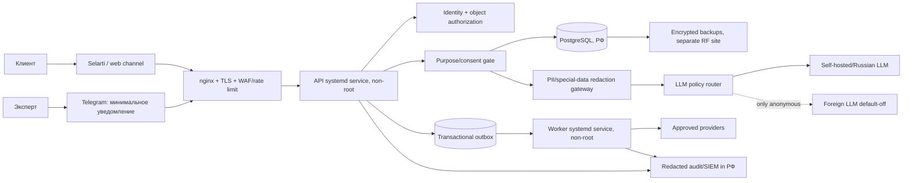
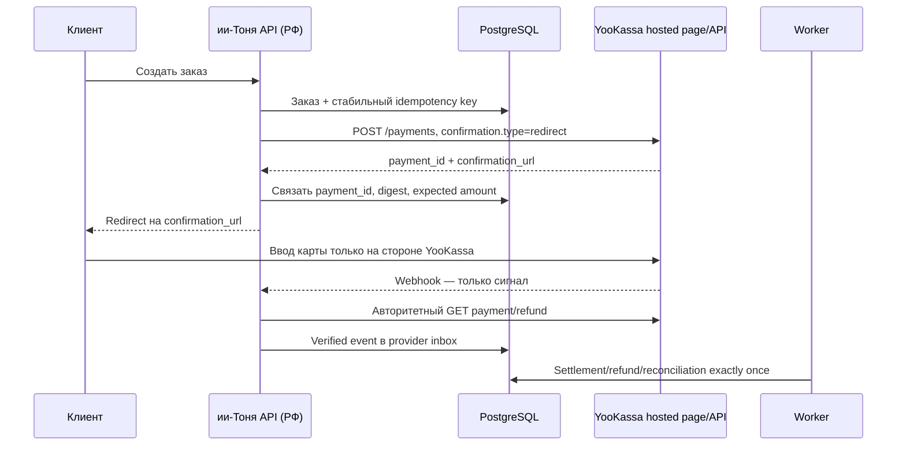

# Российские персональные данные и платежный контур: compliance blueprint для «ии‑Тони»

**Статус:** обязательный pre-production blueprint; сам по себе не является разрешением на запуск  
**Нормативная база проверена:** 27 августа 2026 года  
**Контур:** российские клиенты, эксперты и сотрудники; веб/API, Selarti, Telegram, Planerka, YooKassa, LLM и административные интеграции  
**Владельцы решений:** юридический владелец ПДн, Security, Platform, Payments, Operations  
**Связанные документы:**

- `docs/security/threat-model-and-go-live-gates.md`;
- `docs/superpowers/specs/2026-08-14-yookassa-provider-design.md`;
- `docs/spec/normalized-requirements.md`;
- `docs/runbooks/yookassa-provider.md`.

> Этот документ — применимый проект соответствия и технический baseline, а не индивидуальное юридическое заключение. Пункты, помеченные **LEGAL DECISION**, должны быть утверждены российским юристом по персональным данным с учетом юридического лица, договоров, фактических потоков и состава данных. До этого соответствующая функция остается выключенной.

## 1. Итоговое решение

### 1.1. Рекомендуемая целевая архитектура

Для production следует принять **вариант B — российская зона персональных данных с контролируемым AI-шлюзом**:

1. Все персональные данные, специальные категории, идентификаторы каналов, переписка, платежные факты, журналы доступа, резервные копии и ключи хранятся и обрабатываются в российском контуре.
2. PostgreSQL на выделенном сервере остается единственным источником истины. API и worker работают как отдельные непривилегированные systemd-сервисы за nginx/TLS.
3. Основная LLM работает локально либо у российского поставщика с подтвержденным размещением обработки, логов и резервных копий в РФ и с договором, соответствующим статье 6 части 3 Федерального закона № 152‑ФЗ.
4. Зарубежная LLM по умолчанию отключена. Ей разрешаются только синтетические, публичные или действительно обезличенные задачи, где у платформы нет ключа обратной идентификации. Простая замена имени на UUID является псевдонимизацией и не выводит данные из режима 152‑ФЗ.
5. Оплата выполняется только через redirect/hosted payment page YooKassa. Страница «ии‑Тони» не содержит полей PAN, срока действия, CVC/CVV или PIN, не принимает эти значения и не получает их на сервер.
6. Telegram используется как минимизированный канал управления. Клиентские контакты, текст диалога, safety‑информация и платежные сведения в Telegram не отправляются. Предпочтительный паттерн — непрозрачное уведомление и короткоживущая ссылка в российский кабинет эксперта.
7. Make, Google Sheets, GitHub, зарубежные error trackers, аналитика и support‑системы не получают production‑ПДн. Допускаются только агрегированные анонимные метрики, тестовые синтетические данные и очищенные доказательства без секретов и идентификаторов.

### 1.2. Текущий release posture

До закрытия всех P0‑пунктов ниже состояние остается **NO‑GO** для реальных персональных данных и **NO‑GO** для live‑платежей. Наличие кода, HTTPS, российского сервера или договора с платежным провайдером не заменяет:

- уведомление Роскомнадзора и актуальные сведения в реестре операторов;
- карту целей, данных, оснований, получателей и сроков;
- локальные акты, формы согласий и механизм отзыва;
- модель угроз, определенный уровень защищенности ИСПДн и реализованные меры;
- договоры с обработчиками и проверку всех субподрядчиков;
- процесс уведомления об инциденте в течение 24/72 часов;
- доказательства PCI‑границы и согласованный с эквайером способ валидации;
- проверку фактического размещения данных, журналов и резервных копий в РФ.

### 1.3. Жесткие запреты

В production запрещено:

- хранить PAN, CVC/CVV, полный track, PIN/PIN block или снимки платежной формы;
- встраивать собственные поля карты или проксировать карточные данные через API «ии‑Тони»;
- отправлять персональные или чувствительные диалоги в зарубежную LLM «потому что имя удалено»;
- включать сырой body запросов, provider payload, email, телефон, Telegram ID, confirmation URL, текст диалога или токены в логи;
- размещать production‑ПДн в GitHub issues, PR, CI‑артефактах, тестовых fixtures, Make, Google Sheets или публичных/зарубежных системах наблюдаемости;
- предоставлять сотрудникам общий root/SSH/DB‑аккаунт;
- держать данные «бессрочно», «на всякий случай» или «пока не закончится место»;
- считать TLS, шифрование диска или приватный репозиторий полноценным соответствием 152‑ФЗ;
- включать YooKassa, LLM или иного поставщика одним feature flag без проверенного договора, ключевого контура, матрицы данных и release evidence.

## 2. Область применения и исходные допущения

Документ исходит из следующей фактической модели. Если модель меняется, анализ проводится заново.

- Оператором является российское юридическое лицо или ИП, определяющее цели и состав обработки.
- Сервис работает с гражданами РФ и собирает данные через интернет.
- Данные включают псевдоним/имя, телефон или email, идентификаторы Selarti/Telegram, записи и расписание, сообщения, согласия, обращения в поддержку, платежные и фискальные факты.
- Диалоги и safety‑сценарии могут содержать сведения о физическом или психическом здоровье. Даже если сервис не запрашивает такие сведения целенаправленно, фактическое получение требует защитного режима.
- Сервер production физически расположен в РФ. Это должно подтверждаться договором, адресом площадки, схемой сети и проверкой резервных копий/управляющих сервисов.
- YooKassa используется как платежный провайдер через redirect‑сценарий; живые credentials и provider composition остаются выключенными до отдельного допуска.
- Эксперты являются отдельными получателями ограниченного объема данных. Их юридическая роль — работник, исполнитель по поручению, самостоятельный оператор или иной участник — определяется договором.
- Selarti, Telegram, Planerka, хостер, почта, SMS, LLM, мониторинг и иные сервисы считаются отдельными получателями/обработчиками до доказательства обратного.

**LEGAL DECISION:** утвердить юридическое лицо‑оператора, домены/бренды, роли экспертов и каждого внешнего сервиса. Без этой схемы нельзя корректно заполнить уведомление Роскомнадзора, политику и поручения обработки.

## 3. Что обязательно по закону, а что является дополнительным контролем

| Контроль | Статус | Практическое следствие |
| --- | --- | --- |
| Российские базы данных при интернет‑сборе ПДн граждан РФ | Обязательно по статье 18 части 5 152‑ФЗ | Primary DB, реплики, поиск, object storage, логи и backups с ПДн не выводятся в зарубежные базы; исключения анализируются отдельно |
| Уведомление Роскомнадзора до начала обработки | Обычно обязательно для коммерческого онлайн‑сервиса | Подать уведомление по каждой цели, указать категории, способы, меры, местонахождение БД и трансграничные передачи |
| Политика обработки и локальные акты | Обязательно | Публикация политики на страницах сбора; внутренние документы по целям, срокам, уничтожению, доступам и инцидентам |
| Назначение ответственного за организацию обработки | Обязательно для оператора‑юрлица | Приказ, полномочия, независимый доступ к руководству, контроль и обучение |
| Модель угроз, уровень защищенности и меры ИСПДн | Обязательно | Постановление № 1119 + приказ ФСТЭК № 21; эффективность оценивается до запуска |
| СКЗИ по приказу ФСБ № 378 | Условно обязательно | Применяется, когда криптографические средства используются для выполнения требований защиты; состав определяется моделью угроз |
| Уведомление Роскомнадзора об утечке 24/72 часа | Обязательно | Внутренняя эскалация должна занимать часы, а не дни |
| PCI DSS | Договорное/отраслевое требование платежной экосистемы | Redirect уменьшает scope, но не обнуляет его; способ подтверждения определяет эквайер/платежный партнер |
| WAF, PAM, SIEM, immutable backups, внешний pentest | Обычно best practice или требование партнера | Не всегда названы буквально в 152‑ФЗ, но часто являются рациональным способом доказать исполнение статьи 19 |
| Аттестация ИСПДн и исключительно сертифицированные средства | Не является универсальным требованием для любой частной ИСПДн | Нуждаемость определяется моделью угроз, уровнем, выбранными мерами, отраслевыми условиями и договором; нельзя обещать лишнюю «обязательную сертификацию» |

## 4. Реестр данных и правовые основания

До production создается и утверждается data inventory. Один и тот же атрибут может иметь разные цели и сроки; «единое согласие на всё» недопустимо.

| Класс | Примеры | Основная цель | Возможное основание | Допуск/ограничение |
| --- | --- | --- | --- | --- |
| Идентификация клиента | внутренний ID, channel ID, псевдоним | учетная запись, маршрутизация | договор/действия по инициативе субъекта; закон | минимум полей, object-level authorization |
| Контакт | телефон, email | подтверждение, уведомления, чек | договор; закон; отдельное согласие для маркетинга | хранить отдельно, шифровать на уровне поля, маскировать в UI |
| Бронирование | эксперт, услуга, слот, статус | исполнение услуги | договор | эксперт видит только назначенные записи |
| Диалог | входящее сообщение, ответ | оказание сервиса | договор и/или согласие в зависимости от содержания и функции | короткий срок; raw logging выключен |
| Опциональная память | предпочтения, явно сообщенный контекст | персонализация | отдельное согласие | отдельный toggle, просмотр/редактирование/удаление пользователем |
| Special/safety | сведения о здоровье, кризисное обращение | safety и human handoff | письменное согласие либо конкретное исключение статьи 10, подтвержденное юристом | отдельный логический контур, узкий RBAC, запрет маркетинга/ранжирования |
| Платежный факт | order ID, YooKassa payment ID, сумма, валюта, статус | расчет, возврат, сверка | договор и закон | без карточных реквизитов; append-only evidence |
| Фискальные данные | состав позиции, ставка/режим, контакт для чека, receipt ID | исполнение 54‑ФЗ | закон | срок устанавливает налогово‑бухгалтерская матрица |
| Согласия | версия, цель, канал, время, отзыв, доказательство | доказательство законности | обязанность оператора | append-only события, текущий статус выводится из истории |
| Security/audit | actor, действие, объект, результат, correlation ID | защита и расследование | законный интерес/обязанность защиты | без содержимого диалогов и открытых идентификаторов |
| Маркетинг | сегмент, подписка, кампания | продвижение | отдельное согласие и требования законодательства о рекламе | отделено от сервиса; opt-out не блокирует обязательные сообщения |

### 4.1. Согласие — не универсальная заглушка

152‑ФЗ допускает несколько оснований обработки. Для создания бронирования и оплаты обычно применим договор или действия субъекта до заключения договора; для обязательного учета — закон. Согласие применяется там, где оно действительно требуется или где функция опциональна. Оператор обязан доказать наличие основания [152-6, 152-9].

С 1 сентября 2025 года согласие должно оформляться отдельно от иных документов и информации, которые субъект подтверждает или подписывает [156-FZ, 152-9]. Практически это означает:

- условия сервиса, политика конфиденциальности, согласие на ПДн, маркетинг, optional memory и специальные категории не сливаются в один checkbox;
- у каждой цели собственная версия текста и собственное событие `granted/withdrawn`;
- отказ от маркетинга или optional memory не блокирует исполнение оплаченной услуги;
- интерфейс не использует заранее отмеченные checkbox или темные паттерны;
- доказательство содержит субъект, цель, категории, версию, источник, timestamp, IP/канал в минимальном объеме и способ подтверждения;
- отзыв немедленно запрещает будущую обработку по этому основанию и запускает deletion/restriction workflow.

### 4.2. Специальные категории

Статья 10 относит сведения о здоровье и интимной жизни к специальным категориям. Психологические/кризисные сообщения могут фактически раскрывать сведения о здоровье, даже если продукт позиционируется как информационно‑справочный [152-10].

Для «ии‑Тони» применяется консервативное правило:

- весь необработанный клиентский диалог классифицируется как **high-risk content**;
- выявленная health/safety‑информация не копируется в общий профиль;
- LLM не выводит и не сохраняет диагноз, пол, возраст, семейное положение, сексуальность, доход или состояние здоровья как факт без явной необходимости и утвержденного основания;
- safety‑дело содержит минимум, необходимый оператору, и недоступно support/finance/экспертам;
- письменная форма согласия и применимость исключений статьи 10 определяются юристом до запуска соответствующего сценария.

**LEGAL DECISION:** зафиксировать, какие конкретно health/safety‑сценарии допустимы, нужен ли письменный формат согласия и как обслуживаются несовершеннолетние. Пока решения нет, intentional onboarding несовершеннолетних и долговременная память чувствительных данных запрещены.

### 4.3. Биометрия

Фото, голос или видео не становятся биометрическими персональными данными автоматически. Режим статьи 11 возникает, когда физиологические или биологические характеристики используются для установления личности. «ии‑Тоня» не должна использовать voiceprint, face recognition или иное биометрическое установление личности без отдельного проекта, основания и проверки требований ЕБС/биометрического законодательства.

## 5. Локализация и трансграничная передача

### 5.1. Локализация

При сборе персональных данных граждан РФ, в том числе через интернет, статья 18 часть 5 запрещает запись, систематизацию, накопление, хранение, уточнение и извлечение с использованием баз данных за пределами РФ, кроме ограниченных законных исключений [152-18, 23-FZ]. С 1 июля 2025 года формулировка стала жестче; модель «primary в РФ, рабочая реплика и backups за рубежом» является неприемлемым baseline.

В российском контуре должны находиться:

- PostgreSQL primary и replicas;
- search/vector indexes, если они допускают связь с субъектом;
- object storage и вложения;
- очереди, кэши и data warehouse;
- application/security logs с идентификаторами;
- резервные копии и snapshots;
- KMS/Vault metadata и audit trails;
- LLM prompts, traces, embeddings и conversation memory;
- support tickets и аналитические события, если они содержат ПДн.

Факт размещения подтверждается не маркетинговой надписью «регион РФ», а договором, перечнем площадок, data processing agreement, настройками аккаунта, тестом сетевых endpoints, политикой backups и правом на аудит.

### 5.2. Трансграничная передача

Локализация не дает автоматического разрешения на последующую передачу за рубеж. До начала трансграничной передачи подается отдельное уведомление Роскомнадзору, а оператор собирает предусмотренную статьей 12 информацию о получателе, мерах защиты, прекращении обработки и применимом праве [152-12].

После изменений от 26 июля 2026 года порядок зависит от того, включена ли страна получателя в актуальный перечень стран с адекватной защитой. Для страны вне перечня передача в общем случае не начинается до истечения установленного десятидневного срока рассмотрения уведомления; Роскомнадзор может ограничить или запретить передачу [265-FZ, 152-12]. Перед каждым новым направлением перечень проверяется заново [RKN-128].

Практический register для каждой передачи:

- страна и юридическое лицо получателя;
- роль получателя и субпроцессоры;
- цели, категории субъектов и данных;
- основание обработки и основание передачи;
- физические регионы primary/logs/backups/support;
- срок, удаление, запрет обучения модели и повторного использования;
- технические меры, egress destination и протокол;
- дата/номер уведомления Роскомнадзора и решение;
- владелец ежегодной перепроверки.

### 5.3. Риски конкретных интеграций

| Интеграция | Риск | Production‑решение |
| --- | --- | --- |
| Зарубежная LLM/API | Поручение обработки + трансграничная передача; prompts/traces могут содержать special data | По умолчанию запрещено; только действительно анонимные задачи либо отдельный утвержденный режим статьи 12 |
| Telegram Bot API | Идентификаторы, сообщения и уведомления могут обрабатываться за рубежом | Только минимальное уведомление и непрозрачный ID; детали доступны в российском web‑кабинете; отдельный legal review |
| Google Sheets/Make | Зарубежное хранение, копии и слабая управляемость удаления | Никаких production‑ПДн; только анонимные агрегаты/синтетика |
| GitHub | Код, issues, artifacts и support могут находиться вне РФ | Никаких ПДн, credentials, raw logs, provider payload или подписанных документов; только sanitized evidence |
| Sentry/аналитика/CDN/support | Автоматический сбор IP, URL, headers, user IDs и body | Российский аналог либо строгая фильтрация до отправки и legal review; default deny egress |
| Planerka/Selarti | Юрисдикция и регионы могут быть неочевидны | Получить договорные сведения; передавать минимум; при иностранном контуре применить статью 12 или заменить поставщика |

## 6. Роскомнадзор и организационный контур

### 6.1. Уведомление оператора

Типичный коммерческий интернет‑сервис до начала обработки уведомляет Роскомнадзор по статье 22. Узкие исключения редко применимы к «ии‑Тоне» [152-22]. В уведомлении по каждой цели указываются как минимум:

- цель обработки;
- категории ПДн и субъектов;
- правовые основания;
- перечень действий и способы обработки;
- меры по статьям 18.1 и 19, применяемые СКЗИ;
- ответственное лицо и контакты;
- даты начала/прекращения;
- наличие трансграничной передачи;
- местонахождение баз данных граждан РФ;
- сведения об обеспечении безопасности.

Форма и порядок установлены приказом Роскомнадзора № 180 [RKN-180]. Изменения направляются не позднее 15‑го числа месяца, следующего за месяцем изменения; прекращение обработки — в течение десяти рабочих дней [152-22].

Подача уведомления не является «лицензией» и не доказывает фактическое соответствие. Сведения реестра должны совпадать с production‑архитектурой, договорами и политикой.

### 6.2. Обязательные документы

До production утверждаются:

1. приказ о назначении ответственного за организацию обработки ПДн;
2. публичная политика обработки ПДн;
3. локальная политика/положение об обработке и защите ПДн;
4. перечень ИСПДн, владельцев, целей и мест обработки;
5. data inventory/ROPA по полям, целям, основаниям, получателям и срокам;
6. формы отдельных согласий и доказательства их версий;
7. порядок обработки запросов субъектов;
8. retention and deletion standard;
9. порядок уничтожения и формы актов/выгрузок из журналов;
10. модель угроз, акт определения уровня защищенности, набор мер и отчет оценки эффективности;
11. матрица ролей и доступов, порядок предоставления/отзыва и quarterly review;
12. incident response plan с процессом 24/72 часа;
13. порядок резервного копирования, восстановления и удаления после restore;
14. договоры поручения обработки и реестр субпроцессоров;
15. register трансграничных передач;
16. порядок разработки, тестирования, журналирования и использования обезличенных тестовых данных;
17. обучение сотрудников и NDA/обязательства конфиденциальности;
18. журнал проверок и план корректирующих мероприятий.

Статья 18.1 требует, чтобы локальные акты определяли для каждой цели категории данных/субъектов, способы, сроки обработки и хранения, а также порядок уничтожения. Публичная политика и сведения о мерах защиты должны быть доступны на страницах, где собираются данные [152-18.1].

### 6.3. Договор с обработчиком

Когда поставщик обрабатывает данные по поручению «ии‑Тони», договор должен перечислять данные, операции, цели и включать обязанности по конфиденциальности, локализации, мерам статьи 18.1/19, предоставлению доказательств и уведомлению об инциденте [152-6].

Минимальные договорные условия:

- обработка только по документированным инструкциям;
- запрет изменения цели, обучения моделей и использования для рекламы;
- точные регионы primary/logs/backups/support;
- список и порядок подключения субпроцессоров;
- RBAC, MFA, encryption, vulnerability management и access logging;
- срок уведомления оператора об инциденте не более 4 часов как внутренний договорный SLA;
- возврат/удаление и доказательство уничтожения;
- помощь с запросами субъектов и расследованиями;
- право оператора на документы/аудит;
- запрет перемещения данных без письменного согласования;
- ответственность и порядок завершения договора.

Оператор продолжает отвечать перед субъектом за выбранного обработчика. Нельзя переносить ответственность одной фразой в DPA.

## 7. Права субъектов, сроки и уничтожение

### 7.1. Операционные SLA

Законодательные внешние сроки превращаются во внутренние более короткие SLA:

| Событие | Законодательный предел | Внутренний target |
| --- | ---: | ---: |
| Запрос доступа/информации субъекта | 10 рабочих дней; мотивированное продление максимум на 5 | triage 1 день, ответ до 7 рабочих дней |
| Исправление подтвержденных неточных данных | 7 рабочих дней | до 3 рабочих дней |
| Прекращение неправомерной обработки | 3 рабочих дня | немедленная блокировка, исправление до 2 дней |
| Уничтожение, если легализовать обработку нельзя | 10 рабочих дней | до 7 дней |
| Цель достигнута или согласие отозвано | обычно до 30 дней, если нет иного основания | workflow запускается в день события |
| Требование прекратить обработку | 10 рабочих дней + возможное продление 5 | до 7 дней |
| Уведомление Роскомнадзора об инциденте | 24 часа первичное, 72 часа результаты расследования | legal/security paging до 1 часа, draft до 8/48 часов |

Основание: статьи 20 и 21 [152-20, 152-21].

### 7.2. Retention matrix

У 152‑ФЗ нет единого срока «хранить всё три/пять лет». Срок устанавливается по цели, договору и специальным законам. Финансовые, бухгалтерские и фискальные документы требуют отдельной налогово‑правовой матрицы.

Ниже — **проектные стартовые значения, а не утверждение закона**:

| Класс | Проектный default | Триггер удаления/пересмотра |
| --- | ---: | --- |
| Raw content диалога | 30 дней | окончание диагностической/операционной необходимости; optional memory отдельно |
| Optional memory | до 180 дней с отдельным согласием | отзыв, удаление пользователем, inactivity review |
| HTTP access logs | 30 дней | автоматическая ротация |
| Security/auth logs без content | 180 дней | ротация после расследовательного окна |
| Audit действий с высоким риском | 1 год | ежегодный legal/security review |
| Raw provider webhook/recovery body | 30 дней в зашифрованном виде только при доказанной необходимости | завершенная сверка и отсутствие спора |
| Временные exports | 24 часа | автоматическое удаление после выдачи |
| Daily backups | 35 дней | lifecycle policy; ежемесячный restore test |
| Safety records | срок не установлен до отдельного legal/clinical решения | production‑функция блокируется без утвержденного срока |
| Согласия, финансовый и фискальный audit | по утвержденной evidence/statutory matrix | не удалять произвольно; минимизировать содержимое |

При удалении:

- удаляются primary rows, search/vector indexes, object storage, cache, queues и exports;
- обработчикам направляется команда и собирается доказательство;
- создается акт либо выгрузка из журнала в формате приказа Роскомнадзора № 179 [RKN-179];
- backups не редактируются вручную без необходимости, но имеют короткий lifecycle и недоступны приложению;
- после restore автоматически воспроизводится журнал tombstones, чтобы удаленные профили не «воскресали»;
- ключи уничтожаются/ротируются, когда используется криптографическое стирание;
- факт удаления не содержит больше ПДн, чем требуется для доказательства.

## 8. ИСПДн и техническая защита

### 8.1. Обязательная последовательность

Для каждой ИСПДн:

1. Зафиксировать границы: компоненты, сети, потоки, пользователей, поставщиков, dev/test/prod.
2. Определить категории ПДн, специальные/биометрические данные и количество субъектов.
3. Сформировать модель актуальных угроз.
4. Определить уровень защищенности по постановлению Правительства № 1119 [PP-1119].
5. Выбрать и адаптировать меры приказа ФСТЭК № 21 [FSTEC-21].
6. Если для выполнения требований применяются СКЗИ, учесть приказ ФСБ № 378 [FSB-378].
7. Реализовать организационные и технические меры.
8. До ввода в эксплуатацию оценить эффективность; сохранить программу, протоколы, findings и закрытие рисков.
9. Повторять оценку после существенного изменения архитектуры, состава данных или угроз.

Нельзя заранее записать «УЗ‑3» или «нужна сертификация» без расчета. Это решение делает компетентный специалист по фактической системе; при необходимости привлекается лицензированная организация по технической защите конфиденциальной информации.

### 8.2. Целевая production‑схема

### 8.3. Компоненты и конкретные меры

#### Edge и сеть

- nginx принимает public traffic; API и PostgreSQL не публикуются напрямую;
- TLS 1.2+ с актуальным набором шифров; автоматическое обновление сертификатов;
- rate limit, body size, content-type и schema limits по каждому webhook/endpoint;
- WAF или эквивалентный upstream control; DDoS‑защита с проверенным российским data path;
- trusted proxy chain задается явно; приложение не доверяет публичным `X-Forwarded-*`;
- PostgreSQL слушает private/loopback interface; host firewall deny-by-default;
- outbound egress deny-by-default; разрешены только DNS/NTP, YooKassa и утвержденные endpoints через allowlist/proxy;
- отдельные dev/test/prod credentials и сети; production‑dump не переносится в dev.

#### Application

- API и worker запускаются разными непривилегированными OS‑пользователями;
- read-only application bundle; writable только утвержденные runtime directories;
- строгая schema validation, idempotency и object-level authorization;
- LLM output считается недоверенным текстом/typed intent и не меняет деньги, бронирование, согласия или права без серверной команды;
- raw body и headers не логируются; exception handler удаляет PII/secrets;
- CSRF/SSRF/path traversal/upload controls; malware scanning для вложений;
- dependency pinning, SBOM, secret scanning и проверка release bundle;
- fail-closed startup: незаполненные privacy/payment/LLM policy inputs запрещают функцию.

#### PostgreSQL

Рекомендуемые отдельные роли:

- `migration_owner` — только миграции через контролируемый release;
- `api_rw` — минимальные таблицы/операции API;
- `worker_rw` — outbox, inbox, reconciliation и фоновые задачи;
- `audit_writer` — append-only audit insert;
- `privacy_exporter` — временный controlled export по DSAR;
- `backup_agent` — только backup protocol;
- support/finance не получают прямой SQL‑доступ.

Дополнительно:

- row-level/object authorization реализуется в сервисном слое и проверяется тестами; RLS может служить дополнительным барьером;
- контакты, safety content и recovery body шифруются на уровне приложения envelope encryption;
- ключ/DEK не хранится в той же строке или backup без защиты KEK;
- индексы не включают plaintext email/phone без необходимости; для поиска используются нормализованные keyed digests;
- audit и финансовые ledgers append-only; изменения создают корректирующее событие, а не скрытое редактирование;
- опасные bulk query/export требуют отдельной роли, reason code и dual approval.

#### Secrets и KMS

- никакие secrets не находятся в Git, `.env`, shell history, issue, CI artifact или prompt;
- на переходном этапе — root-owned systemd credentials с правами `0400`, ограниченные конкретным service user;
- целевой контур — Vault/KMS/HSM в РФ с audit, rotation и separation of duties;
- envelope encryption: уникальные DEK по классу/объекту, KEK в KMS;
- rotation policy: немедленно при инциденте/увольнении, регулярно по утвержденному графику;
- backup keys отделены от backup storage и production host;
- break-glass access одноразовый, с MFA, ticket/reason и автоматическим отзывом.

#### Backups

- шифрование до отправки;
- отдельный аккаунт/площадка в РФ и отсутствие постоянных write credentials у приложения;
- immutable/WORM window как best practice;
- ежедневный автоматический backup, регулярный проверочный restore в изолированную среду;
- RPO/RTO, результат restore, checksum и версия схемы фиксируются;
- restore environment не имеет исходящего доступа к поставщикам;
- после restore выполняются tombstones/deletion ledger и rotation временных ключей.

#### Логи, SIEM и мониторинг

Допустимые поля:

- timestamp, service, environment;
- correlation ID;
- код операции и bounded outcome;
- actor type и односторонний keyed hash внутреннего ID;
- latency, status class и error code без body.

Запрещенные поля:

- имя, email, телефон, channel/Telegram ID в открытом виде;
- текст диалога, safety note, prompt/response;
- Authorization/Cookie, bot token, webhook secret;
- YooKassa secret, idempotency key, confirmation URL;
- raw provider/payment payload.

Алерты минимум:

- массовый/необычный read/export;
- login/MFA anomalies и privilege change;
- отключение audit/backup/EDR;
- ошибки KMS/decryption;
- outbound connection вне allowlist;
- повторные webhook mismatch и provider reconciliation anomaly;
- изменение feature flag/credential/payment mode;
- изменение retention/lifecycle policy.

### 8.4. RBAC и least privilege

| Роль | Разрешено | Запрещено |
| --- | --- | --- |
| Support | маскированный профиль, статус собственных support‑кейсов, бронирование | raw chat, safety, полные контакты, платежные credentials, bulk export |
| Safety operator | только назначенный safety‑кейс и минимальный контакт | платежи, маркетинг, чужие кейсы, full history без необходимости |
| Finance | order/payment/refund/receipt state, маскированный контакт | диалоги, profile memory, safety content, DB admin |
| Expert | свои назначенные записи, псевдоним и разрешенная заметка | контакты без необходимости, balances, полная история, чужие клиенты |
| Privacy officer | DSAR workflow, legal register, deletion approvals | произвольная продуктовая работа от имени клиента |
| SRE | health/metrics, deployment, break-glass infrastructure | routine чтение бизнес‑данных; прямой content access без incident ticket |
| DBA | schema/backup/restore по change ticket | использование данных для support; unrestricted export |
| Security auditor | audit/security evidence, configuration snapshot | изменение финансового/клиентского состояния |
| Service accounts | только конкретные RPC/table/queue | interactive login и shared credentials |

Обязательные правила:

- MFA для людей с административным доступом;
- запрет общих аккаунтов;
- joiner/mover/leaver SLA — отзыв в день прекращения полномочий;
- quarterly access review;
- dual approval для bulk export, key recovery, временного доступа к raw content и высокорисковых возвратов;
- session recording для bastion/PAM как maturity target;
- доступ SRE/DBA к содержимому — только break-glass с reason, сроком и post-review.

## 9. Платежные данные, YooKassa и PCI DSS

### 9.1. Граница между ПДн и карточными данными

Платежный факт — персональные данные, когда он связан с клиентом. Карточные реквизиты дополнительно попадают в область PCI DSS. Эти режимы пересекаются, но не заменяют друг друга.

Сервер «ии‑Тони» может хранить:

- внутренний `order_id`;
- YooKassa `payment_id`/`refund_id`;
- сумму в целых копейках и валюту;
- status и timestamps;
- provider environment (`test/live`);
- request digest, reconciliation и immutable financial events;
- receipt reference и минимальный контакт для чека при наличии правового основания;
- необязательные masked brand/last4 только если это действительно нужно support и возвращено провайдером.

Сервер не хранит и не принимает:

- PAN полностью или частично, если нет доказанной необходимости;
- CVC/CVV/CID;
- magnetic stripe/track data;
- PIN/PIN block;
- содержимое hosted payment page;
- скриншоты карты;
- данные карты из чата или support tickets.

PCI SSC запрещает хранить sensitive authentication data после авторизации даже в зашифрованном виде [PCI-SAD].

### 9.2. Обязательный redirect‑сценарий

Сохраняются требования действующего YooKassa design:

- fixed API origin и отдельные `shop_id/secret_key`;
- stable idempotency, exact integer money и test/live separation;
- webhook не является финансовой истиной; всегда выполняется авторитетный GET;
- raw provider body, contact и confirmation URL не логируются;
- timeout после POST — unknown outcome, а не «неуспешно»; сначала reconciliation;
- фискальный режим и контакт для чека fail closed;
- encrypted exact-body recovery включается только с утвержденной целью, ключом и коротким retention;
- `YOOKASSA_ENABLED=false` сохраняется до полного evidence pack.

### 9.3. PCI scope

Redirect/hosted page существенно уменьшает PCI scope, но не делает merchant environment «вне PCI». По материалам PCI SSC:

- SAQ A применим только если все элементы платежной страницы поступают от PCI‑совместимого провайдера и выполнены все критерии [PCI-SAQ-A];
- merchant website остается в scope как возможная точка перенаправления/атаки [PCI-MERCHANT-SITE];
- для текущего SAQ A redirect/e-commerce контура могут требоваться внешние ASV‑сканы; окончательный validation method устанавливает эквайер/платежный партнер [PCI-ASV].

До live‑платежей получить от YooKassa/эквайера письменное подтверждение:

1. применимый SAQ и версия PCI DSS;
2. перечень in-scope доменов/IP;
3. периодичность ASV scan и требования к remediation;
4. требуемые AOC/SAQ/attestation artifacts;
5. правила использования hosted redirect, webhook и payment method metadata;
6. требования к incident notification и forensic provider;
7. обязанность ежегодно подтверждать PCI‑статус YooKassa как service provider.

Не реализовывать собственную token vault. Если позже появятся сохраненные способы оплаты/recurring, использовать provider-owned token/payment method ID и провести новый PCI/privacy review.

### 9.4. Контакт для чека

Email/телефон для чека — ПДн. Передавать YooKassa только минимально необходимый контакт, полученный из утвержденного источника с подходящим основанием. Не копировать его в description/metadata. Внутренне хранить отдельно, шифровать и маскировать; срок определяется фискальной и доказательственной матрицей, а не жизненным циклом маркетингового профиля.

**LEGAL DECISION:** утвердить юрлицо‑продавца, 54‑ФЗ сценарий, номенклатуру, НДС/без НДС, предмет/способ расчета, формат чека, возвраты и сроки хранения фискальных данных с бухгалтером и платежным юристом.

## 10. Три архитектурных варианта

### Вариант A — MVP с минимальным риском

**Состав:** один выделенный сервер в РФ, nginx, API/worker, PostgreSQL, локальная LLM либо российский API, зашифрованный backup на второй российской площадке, YooKassa redirect.

**Ограничения:**

- Telegram — только непрозрачные уведомления;
- без foreign LLM, Google Sheets, Make, foreign analytics;
- raw conversation 30 дней;
- optional memory, minors и сложные safety‑профили выключены;
- support через российский кабинет;
- минимум поставщиков и data flows.

**Плюсы:** самый быстрый путь к доказуемому соответствию, низкий blast radius.  
**Минусы:** ниже качество/масштаб AI, больше ручных операций, single-host risk компенсируется backups и recovery.

### Вариант B — production-компромисс, рекомендуется

**Состав:** российская PD zone, выделенные API/worker/PostgreSQL/object storage/KMS/SIEM, purpose/consent service, redaction gateway, LLM policy router, российская основная LLM, deny-by-default egress.

**Foreign path:** только для контента, прошедшего deterministic classifier и policy gate как публичный/синтетический/анонимный. Любой ID, свободный пользовательский текст, embedding или возможность связать результат с человеком блокируют маршрут.

**Плюсы:** масштабируемость и возможность использовать внешние модели для безопасных задач.  
**Минусы:** сложнее доказать отсутствие ПДн; необходимы DLP tests, egress evidence и постоянный контроль.

### Вариант C — максимально строгий российский контур

**Состав:** все приложения, LLM/embeddings, KMS/HSM, SIEM, email/SMS, support, object storage, backups и админ‑доступы находятся в РФ; Telegram заменен российским кабинетом/каналом; трансграничных передач нет.

**Плюсы:** минимальный regulatory ambiguity, удобнее для крупных банков и чувствительных сценариев.  
**Минусы:** максимальные стоимость, эксплуатационная сложность и зависимость от локального AI‑стека.

### Решение

Принять вариант B как target, но запускать через ограничения варианта A. Иными словами: сначала доказуемый российский моноконтур, затем добавлять компоненты только после threat/privacy review. Foreign LLM не является обязательной частью target и может навсегда остаться выключенной.

## 11. Инциденты и утечки

Статья 21 требует уведомить Роскомнадзор:

- в течение 24 часов — о факте инцидента, предполагаемых причинах/вреде, принятых мерах и контактном лице;
- в течение 72 часов — о результатах внутреннего расследования и, при наличии, виновных лицах [152-21].

### 11.1. Внутренний процесс

1. Любой сотрудник/алерт создает security incident без копирования ПДн в зарубежный ticket.
2. On-call в течение 15 минут подтверждает событие и назначает incident commander.
3. В течение 1 часа подключаются Security, Privacy/Legal, Platform и владелец затронутой функции.
4. Сохраняются логи/снимки только в российском evidence vault; доступ фиксируется.
5. Изолируются credentials, endpoints, service accounts и egress; финансовые операции fail closed.
6. Определяются категории/количество субъектов, период, получатели, последствия и меры.
7. До 8 часов готовится проект 24‑часового уведомления; до 48 часов — проект 72‑часового отчета.
8. При необходимости субъектам/партнерам направляется утвержденное уведомление.
9. После containment — root cause, corrective actions, owner/date и проверка эффективности.
10. Секреты, ключи и sessions ротируются; затронутые backups и subprocessors проверяются.

### 11.2. Минимальный incident evidence

- timeline в UTC;
- система/версия/release SHA;
- обнаружение и источник сигнала;
- категории и оценка количества субъектов;
- какие данные фактически доступны/выгружены;
- containment и rotation;
- уведомления/номера отправок;
- forensic findings и root cause;
- список корректирующих мер;
- подтверждение удаления у получателей, если применимо.

## 12. План внедрения

### P0 — до любых реальных ПДн и live‑платежей

- [ ] Утвердить юрлицо‑оператора и роли всех участников.
- [ ] Назначить ответственного за организацию обработки ПДн.
- [ ] Провести data discovery и заполнить inventory по каждой цели/полю/системе.
- [ ] Подать/обновить уведомление Роскомнадзора и сверить запись реестра.
- [ ] Утвердить публичную политику, отдельные согласия и механизм отзыва.
- [ ] Определить special-category и minors posture; неподтвержденные функции выключить.
- [ ] Заключить договоры с хостером, Selarti, Planerka, LLM, YooKassa и иными получателями либо убрать интеграцию.
- [ ] Подтвердить российское размещение DB, logs, object storage, backups, KMS и support.
- [ ] Закрыть foreign egress по умолчанию; запретить production‑ПДн в GitHub/Make/Sheets/analytics.
- [ ] Сформировать модель угроз, определить уровень защищенности и набор мер 1119/ФСТЭК‑21.
- [ ] Реализовать MFA, RBAC, уникальные аккаунты, JML и quarterly access review.
- [ ] Убрать secrets из `.env`/репозитория; внедрить controlled systemd credentials/KMS и rotation.
- [ ] Включить encryption at rest/in transit и field encryption для контактов/safety/recovery.
- [ ] Настроить redacted audit, SIEM alerts и deny-by-default logging schema.
- [ ] Утвердить retention matrix и автоматическое уничтожение, включая restore tombstones.
- [ ] Настроить encrypted RF backups и выполнить успешный restore drill.
- [ ] Утвердить incident runbook и провести tabletop на сроки 24/72 часа.
- [ ] Сохранить YooKassa redirect-only и `YOOKASSA_ENABLED=false` до provider evidence.
- [ ] Получить от эквайера решение по SAQ/ASV/PCI scope.
- [ ] Выполнить оценку эффективности мер до production.

### P1 — перед масштабированием и после test-shop

- [ ] Провести независимый application/infrastructure pentest и закрыть high/critical findings.
- [ ] Выполнить требуемый ASV scan и remediation.
- [ ] Проверить YooKassa test-shop: payment, refund, receipt, webhook, unknown outcome, reconciliation.
- [ ] Провести DLP/egress tests: prompts, errors, logs и exports не покидают РФ.
- [ ] Внедрить central KMS/Vault и отделить backup keys.
- [ ] Автоматизировать DSAR export/correction/deletion с approval и audit.
- [ ] Ввести vendor/subprocessor review и ежегодное подтверждение размещения.
- [ ] Проверять policy/consent version compatibility на каждом purpose gate.
- [ ] Внедрить immutable audit для admin/finance/privacy операций.
- [ ] Проводить quarterly access review, restore test и incident exercise.
- [ ] Добавить privacy/security regression tests в release gate.

### P2 — зрелый контур

- [ ] PAM/bastion с session recording и just-in-time access.
- [ ] HSM/managed KMS, automated key rotation и crypto-shredding.
- [ ] Отдельные DB/keys для identity, conversations, safety и finance.
- [ ] Continuous asset/vulnerability management, EDR и configuration drift detection.
- [ ] Внешняя проверка ИСПДн/152‑ФЗ и merchant PCI evidence ежегодно.
- [ ] Замена remaining foreign channels на российский кабинет.
- [ ] Self-hosted AI/embeddings и полный отказ от foreign model path для client workload.
- [ ] Red-team упражнение на prompt injection, data exfiltration, insider export и provider compromise.

## 13. Что запросит банк, YooKassa, эквайер или регулятор

Подготовить evidence pack без реальных ПДн:

### Corporate/legal

- реквизиты и полномочия юрлица;
- актуальная запись в реестре операторов Роскомнадзора;
- политика ПДн и приказы;
- data inventory и схема ролей operator/processor/recipient;
- формы согласий и version history;
- договоры поручения, список субпроцессоров и register трансграничных передач;
- legal memo по special data, minors, marketing и retention;
- 54‑ФЗ/фискальная конфигурация, утвержденная бухгалтером.

### Architecture/security

- актуальная data-flow/network diagram;
- подтверждение российских регионов primary/logs/backups/KMS;
- модель угроз, определенный уровень и перечень мер;
- отчет оценки эффективности, vulnerability scans и pentest remediation;
- IAM/RBAC matrix, MFA/JML/access review evidence;
- secrets/KMS/rotation procedure;
- backup, restore и deletion evidence;
- incident plan и результаты tabletop;
- sanitized log samples, SIEM alerts и egress policy;
- SBOM, release checksums/signature и change management.

### Payments/PCI

- схема redirect‑интеграции и заявление «cardholder data not collected/stored»;
- согласованный SAQ/AOC и ASV reports;
- PCI status/AOC YooKassa как service provider, если предоставляется;
- webhook authentication/source control и authoritative GET evidence;
- test/live segregation;
- idempotency, reconciliation, refund и unknown-outcome tests;
- no-secret/no-PII logging tests;
- fiscal receipt test evidence;
- provider incident contacts и escalation SLA.

Не размещать подписанные договоры, паспорта, ФИО сотрудников, реальные scan reports с внутренними адресами или raw provider fixtures в GitHub. В репозитории хранить только sanitized index, hashes, шаблоны и release evidence; оригиналы — в российском DMS/evidence vault.

## 14. Pre-audit checklist

### Governance и Роскомнадзор

- [ ] Фактический оператор совпадает с политикой, договорами, сайтом и merchant account.
- [ ] Уведомление Роскомнадзора подано до обработки и отражает все цели.
- [ ] В реестре указаны фактические адреса российских БД.
- [ ] Изменения реестра имеют owner и календарный контроль срока.
- [ ] Ответственный назначен приказом и имеет прямой канал к руководителю.
- [ ] Все сотрудники прошли обучение и подписали обязательства конфиденциальности.
- [ ] Политика размещена на каждой странице/форме сбора.
- [ ] Локальные акты содержат сроки и способ уничтожения для каждой цели.

### Data inventory и основания

- [ ] Для каждого поля есть purpose, basis, owner, recipient, retention и deletion trigger.
- [ ] Contract basis не подменен ненужным согласием.
- [ ] Optional memory и marketing имеют отдельные согласия.
- [ ] Согласия отделены от условий/политики и имеют versioned evidence.
- [ ] Отзыв блокирует будущую обработку и запускает workflow.
- [ ] Special data и minors имеют отдельное утвержденное решение либо функции выключены.
- [ ] Не выполняется скрытое inference пола, возраста, здоровья, сексуальности или дохода.
- [ ] Эксперт видит только данные назначенного клиента и конкретной записи.

### Локализация и поставщики

- [ ] PostgreSQL, replicas, object storage, logs, backups и KMS физически в РФ.
- [ ] Проверены регионы support, telemetry и control plane каждого поставщика.
- [ ] В договорах закреплены инструкции, регионы, subprocessors, deletion и incident SLA.
- [ ] Есть ежегодный vendor review и право получить доказательства.
- [ ] Foreign egress закрыт firewall/proxy policy.
- [ ] GitHub/Make/Sheets/Sentry не получают production‑ПДн.
- [ ] Telegram не содержит контактов, диалогов, safety или payment data.
- [ ] Любая трансграничная передача имеет register, уведомление и legal approval.

### ИСПДн и доступ

- [ ] Границы ИСПДн и data flows актуальны.
- [ ] Модель угроз и уровень защищенности соответствуют фактической системе.
- [ ] Меры ФСТЭК‑21 реализованы либо есть утвержденное обоснование неприменимости.
- [ ] Применение СКЗИ и приказа ФСБ‑378 оценено специалистом.
- [ ] Оценка эффективности выполнена до production и после существенных изменений.
- [ ] MFA включена для всех административных ролей.
- [ ] Общих/root accounts нет; SSH/DB access индивидуален.
- [ ] Support/finance не имеют прямого SQL‑доступа.
- [ ] Break-glass ограничен временем, ticket и post-review.
- [ ] Quarterly access review и JML доказуемы.

### Application, logs и AI

- [ ] Raw request/response, prompt и provider body не логируются.
- [ ] Error reporting очищает headers, query, body и identifiers до отправки.
- [ ] LLM output не имеет прямой authority над money/bookings/consent/RBAC.
- [ ] PII/special-data gateway покрыт unit/integration/adversarial tests.
- [ ] Foreign LLM route выключен и deny-by-default.
- [ ] Псевдонимизированные данные не ошибочно названы анонимными.
- [ ] Production fixtures и CI evidence не содержат ПДн/секретов.
- [ ] Egress allowlist и alert на нарушение протестированы.
- [ ] Bulk export требует dual approval и автоматически удаляется.

### Retention, backups и DSAR

- [ ] Нет бессрочных категорий без отдельного закона/основания.
- [ ] Lifecycle policies соответствуют утвержденной retention matrix.
- [ ] Уничтожение создает доказательство по приказу № 179.
- [ ] Удаление распространяется на indexes, objects, cache, processors и exports.
- [ ] Backups зашифрованы, в РФ и имеют короткий lifecycle.
- [ ] Restore drill успешен и воспроизводит tombstones.
- [ ] DSAR доступ/исправление/удаление укладываются во внутренние SLA.
- [ ] Temporary exports удаляются автоматически и не уходят по обычной почте.

### Инциденты

- [ ] Incident commander, Privacy/Legal и контакты Роскомнадзора назначены.
- [ ] Шаблоны 24‑ и 72‑часового уведомления подготовлены.
- [ ] Vendor incident SLA позволяет уложиться в 24 часа.
- [ ] Evidence vault расположен в РФ и доступ аудируется.
- [ ] Tabletop включает утечку через LLM, Telegram, support и payment provider.
- [ ] Проверены containment, credential rotation и массовый session revoke.

### YooKassa и PCI

- [ ] Checkout — только redirect на hosted YooKassa page.
- [ ] На домене «ии‑Тони» отсутствуют поля и JS для ввода карты.
- [ ] PAN/CVC/track/PIN отсутствуют в DB, logs, analytics, support и backups.
- [ ] Confirmation URL и YooKassa secret не логируются.
- [ ] Webhook используется только как сигнал; settlement после authoritative GET.
- [ ] Unknown outcome reconciled до повторной финансовой операции.
- [ ] Test/live credentials, DB evidence и runtime разделены.
- [ ] Fiscal contact имеет основание, минимизирован и шифруется.
- [ ] Эквайер письменно подтвердил SAQ/ASV scope.
- [ ] ASV/pentest findings закрыты.
- [ ] Provider test-shop evidence включает payment/refund/receipt/replay/reconciliation.
- [ ] `YOOKASSA_ENABLED` остается `false`, пока каждый gate не подписан.

## 15. Fail-closed go-live gates

Production и live‑платежи блокируются, если выполняется хотя бы одно условие:

- нет утвержденного оператора или актуального уведомления Роскомнадзора;
- неизвестно, где поставщик хранит logs/backups/support data;
- foreign service получает production‑ПДн без завершенного режима статьи 12;
- special/safety processing не имеет утвержденного основания и срока;
- модель угроз/уровень/меры не соответствуют текущей архитектуре;
- нет MFA, индивидуальных аккаунтов, backup restore или incident process;
- raw PII/secrets обнаружены в логах, GitHub, fixtures или telemetry;
- payment page принимает карточные данные на стороне «ии‑Тони»;
- эквайер не подтвердил PCI validation method;
- YooKassa fiscal, webhook, reconciliation или key-management inputs неполны;
- high/critical security finding открыт;
- release evidence не относится к точному production SHA/configuration.

## 16. Решения, которые нельзя додумывать в коде

До финального юридического review закрыть:

1. **Оператор и роли:** кто является оператором, кем являются эксперты, Selarti, Planerka и YooKassa по каждой цели.
2. **Специальные данные:** какие health/safety‑сценарии реально обрабатываются, нужен ли письменный формат согласия и какие исключения применимы.
3. **Несовершеннолетние:** возрастной порог, проверка возраста, законный представитель и UX отказа.
4. **Трансграничные передачи:** Telegram и любой foreign AI/analytics/support; страны, уведомления и запреты.
5. **Retention:** договорные, исковые, бухгалтерские, налоговые, фискальные и safety сроки.
6. **ИСПДн:** фактический уровень защищенности, актуальные угрозы, применение сертифицированных средств/СКЗИ и формат оценки эффективности.
7. **PCI:** применимый SAQ, ASV scope и дополнительные требования YooKassa/эквайера.
8. **54‑ФЗ:** продавец, receipt scenario, НДС, предмет/способ расчета, возврат и контакт.
9. **Маркетинг/cookies:** отдельные согласия, аналитика и требования рекламы/электронных сообщений.
10. **Data subject UX:** каналы доступа, исправления, удаления, ограничения и идентификация заявителя.

Ни одно из этих решений не должно появляться как «разумный default» разработчика.

## 17. Нормативные и отраслевые источники

Ссылки ниже используются для проверки вывода. Перед production audit необходимо повторно проверить редакции и официальные публикации.

### Федеральный закон № 152‑ФЗ

- **[152]** Консолидированный текст, редакция с учетом изменений от 26.07.2026: <https://www.consultant.ru/document/cons_doc_LAW_61801/>
- **[152-6]** Статья 6, условия обработки и поручение: <https://www.consultant.ru/document/cons_doc_LAW_61801/315f051396c88f1e4f827ba3f2ae313d999a1873/>
- **[152-9]** Статья 9, согласие: <https://www.consultant.ru/document/cons_doc_LAW_61801/6c94959bc017ac80140621762d2ac59f6006b08c/>
- **[152-10]** Статья 10, специальные категории: <https://www.consultant.ru/document/cons_doc_LAW_61801/26edb2934b899bf9c74c3a8f7e574651c6565e6d/>
- **[152-12]** Статья 12, трансграничная передача: <https://www.consultant.ru/document/cons_doc_LAW_61801/e4ebbe1780de623c7cf32a59ca82a7bb523a25dd/>
- **[152-18]** Статья 18, обязанности при сборе и локализация: <https://www.consultant.ru/document/cons_doc_LAW_61801/cbf4e15b7c330f9372e876cdf2bc928bad7950ef/>
- **[152-18.1]** Статья 18.1, меры оператора: <https://www.consultant.ru/document/cons_doc_LAW_61801/eeeebe22bf738fd65bb66b95cc278911ae2525ee/>
- **[152-19]** Статья 19, безопасность: <https://www.consultant.ru/document/cons_doc_LAW_61801/ca9e5658710519f09ab2fdb8196fcb3eb024a051/>
- **[152-20]** Статья 20, обращения субъектов: <https://www.consultant.ru/document/cons_doc_LAW_61801/7aeb0acd5aa76dbc888a07e52ca06a92568c6e96/>
- **[152-21]** Статья 21, прекращение, уничтожение и инциденты: <https://www.consultant.ru/document/cons_doc_LAW_61801/d3fe43a7c415353b17faab255bc0de92bea127da/>
- **[152-22]** Статья 22, уведомление Роскомнадзора: <https://www.consultant.ru/document/cons_doc_LAW_61801/d996966e22e1320c9de1ab82d9f6be12c3d9d765/>
- **[152-22.1]** Статья 22.1, ответственный: <https://www.consultant.ru/document/cons_doc_LAW_61801/ac39e94238689d353ef880365b6b400140aa1d2d/>

### Изменения и акты Роскомнадзора

- **[23-FZ]** Федеральный закон № 23‑ФЗ от 28.02.2025, изменение локализации с 01.07.2025: <https://publication.pravo.gov.ru/document/0001202502280034>
- **[156-FZ]** Федеральный закон № 156‑ФЗ от 24.06.2025, отдельное согласие с 01.09.2025: <https://publication.pravo.gov.ru/document/0001202506240021>
- **[265-FZ]** Федеральный закон № 265‑ФЗ от 26.07.2026, актуальные изменения статьи 12: <https://publication.pravo.gov.ru/document/0001202607260024>
- **[RKN-128]** Приказ Роскомнадзора № 128 от 05.08.2022, перечень стран с адекватной защитой: <https://publication.pravo.gov.ru/Document/View/0001202209200008>
- **[RKN-178]** Приказ Роскомнадзора № 178 от 27.10.2022, оценка вреда: <https://publication.pravo.gov.ru/Document/View/0001202211290004>
- **[RKN-179]** Приказ Роскомнадзора № 179 от 28.10.2022, подтверждение уничтожения: <https://publication.pravo.gov.ru/Document/View/0001202211290008>
- **[RKN-180]** Приказ Роскомнадзора № 180 от 28.10.2022, формы уведомлений: <https://publication.pravo.gov.ru/Document/View/0001202212150022>

### Защита ИСПДн

- **[PP-1119]** Постановление Правительства РФ № 1119 от 01.11.2012: <https://www.consultant.ru/document/cons_doc_LAW_137356/>
- **[FSTEC-21]** Приказ ФСТЭК России № 21 от 18.02.2013, действующий baseline для мер защиты в ИСПДн: <https://www.consultant.ru/document/cons_doc_LAW_146520/>
- **[FSB-378]** Приказ ФСБ России № 378 от 10.07.2014, меры при использовании СКЗИ: <https://www.consultant.ru/document/cons_doc_LAW_167862/>

### YooKassa и PCI SSC

- **[YK-PROCESS]** YooKassa, процесс платежа и redirect confirmation: <https://yookassa.ru/developers/payment-acceptance/getting-started/payment-process>
- **[YK-API]** YooKassa, формат взаимодействия, аутентификация и идемпотентность: <https://yookassa.ru/developers/using-api/interaction-format>
- **[PCI-SAQ-A]** PCI SSC FAQ 1293, критерий происхождения элементов payment page: <https://www.pcisecuritystandards.org/faqs/1293/>
- **[PCI-ASV]** PCI SSC FAQ 1604, SAQ A и ASV scanning, июнь 2026: <https://www.pcisecuritystandards.org/faqs/1604/>
- **[PCI-MERCHANT-SITE]** PCI SSC, merchant website остается в scope при SAQ A: <https://www.pcisecuritystandards.org/faqs/is-a-merchant-website-still-in-scope-for-pci-dss-if-it-meets-all-the-criteria-for-saq-a/>
- **[PCI-SAD]** PCI SSC FAQ 1533, запрет хранения sensitive authentication data после авторизации: <https://www.pcisecuritystandards.org/faqs/1533/>
- **[PCI-RETENTION]** PCI SSC FAQ 1318, минимизация и удаление cardholder data: <https://www.pcisecuritystandards.org/faqs/1318/>

## 18. Контроль актуальности

Владелец Privacy/Legal проверяет документ:

- перед каждым production/live-provider запуском;
- при добавлении нового поставщика, страны, канала, категории данных или цели;
- при изменении LLM, логирования, backups, support или payment flow;
- не реже одного раза в квартал по 152‑ФЗ, актам Роскомнадзора/ФСТЭК/ФСБ и перечню стран;
- ежегодно по PCI DSS и требованиям эквайера;
- немедленно после инцидента или существенного regulatory change.

Изменение документа не активирует функцию автоматически. Активация требует exact‑SHA evidence, независимого review и явного release authorization.