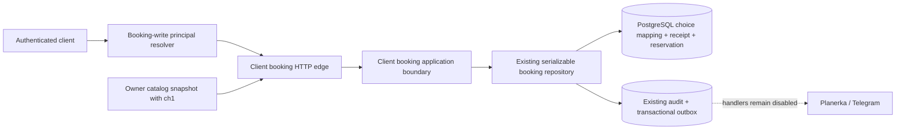

# Architecture Spine — MVP Client Booking 001

## Design Paradigm

The authenticated HTTP edge receives only opaque public references. PostgreSQL resolves them to
protected local facts and extends the existing serializable booking transaction. The domain
state machine, BookingService, PostgresBookingRepository, audit, and outbox remain the only
reservation mutation path; provider adapters remain disabled outer capabilities.

## Inherited Invariants

| Inherited | From parent | Binds here |
| --- | --- | --- |
| Catalog AD-1/AD-2 | catalog spine at `3db7ad1` | request/outbox atomicity and immutable first-write snapshot |
| Catalog AD-3/AD-4 | catalog spine at `3db7ad1` | fresh local facts and owner-derived authority |
| Catalog AD-5/AD-6 | catalog spine at `3db7ad1` | explicit payload compatibility, default-off gates, retention and minimization |
| Principal AD-1/AD-4 | principal spine at `94ad64c` | injected trust and fresh PostgreSQL authority resolution |
| Principal AD-5/AD-6 | principal spine at `94ad64c` | principal-derived ownership and normalized `401|503` failures |
| Principal AD-7/AD-8 | principal spine at `94ad64c` | no provider/business authority from session state; activation is separate from verification |
| Reservation state machine | `packages/domain/src/reservation.ts` | only existing transitions; no client-only parallel state |
| Booking transaction | `PostgresBookingRepository` at `3db7ad1` | capacity, overlap, deadline, audit, outbox, capped serialization retry |

## Invariants & Rules

### AD-1 — Booking write authority is a separate injected capability [ADOPTED]

- **Binds:** CAP-1, CAP-2, CBK-001, CBK-002, HTTP composition.
- **Prevents:** catalog-read scope, Selarti identity, body data, or an allow-all fallback becoming
  reservation authority.
- **Rule:** Register booking routes only with both default-off feature capability and an injected
  resolver that freshly proves `client_booking:write`, active canonical internal `userId`, and the
  principal contract's exact credential grammar; `client_catalog:read` alone is denied.

### AD-2 — Catalog choices are protected references

- **Binds:** CAP-1, CBK-003, CBK-004, catalog worker and repository.
- **Prevents:** internal slot/service/expert/provider IDs crossing HTTP or a caller inventing a
  selection.
- **Rule:** Booking-aware v2 materialization atomically stores an owner/request/slot mapping keyed
  by SHA-256 of a random `ch1` handle and serializes only that handle plus `startsAt`; v1 snapshots
  remain immutable and unbookable. The protected choice expires at
  `min(request.expires_at, slot.observed_at + 15 minutes, slot.starts_at - 24 hours)`.

### AD-3 — Existing booking transaction owns reserve

- **Binds:** CAP-1, CAP-3, CBK-006, CBK-007, CBK-011, BookingService and repository.
- **Prevents:** choice validation committing separately from capacity, reservation, receipt,
  audit, or outbox.
- **Rule:** Extend the existing serializable repository operation so one database-clock
  transaction validates protected choice and all existing eligibility rules, derives idempotency,
  inserts the reservation/public receipt, and emits the existing audit/outbox facts atomically.

### AD-4 — Idempotency and public booking identity are server-owned

- **Binds:** CAP-1, CAP-2, CBK-005, CBK-006, CBK-008.
- **Prevents:** caller key collision, replay creating another reservation, or internal reservation
  ID becoming the public API key.
- **Rule:** Reserve identity is a versioned SHA-256 of authenticated user plus choice digest;
  cancel identity derives from protected reservation plus literal client-cancel. A random `bk1`
  handle is stored in the unique owner receipt and every replay returns that receipt. Handle
  collision regeneration is bounded to three transactional attempts; exhaustion rolls back.

### AD-5 — Choice coordination extends, but does not reorder, existing lock protocols

- **Binds:** CAP-3, CBK-010, reserve, cancel, catalog retention, subject erasure and expiry.
- **Prevents:** deadlock drift, oversubscription, use-after-expiry, resurrection, and double
  capacity release.
- **Rule:** Reserve, catalog retention, and choice cleanup coordinate on one choice-digest advisory
  key. Only reserve may proceed from that lock into the existing sorted booking advisory/row-lock
  protocol. Retention never acquires booking locks. Subject erasure terminalizes active
  reservations using the existing booking transition first, releases those locks, then performs
  choice/receipt cleanup in a separate retryable phase; it never holds a choice lock while
  requesting a booking lock. Implementation surveys and ratifies the merged principal, catalog,
  privacy, and booking topology before adding locks. Every losing serialization/state predicate
  produces replay, pending erasure, not-found, or conflict without a duplicate effect.

### AD-6 — HTTP is an opaque public projection

- **Binds:** CAP-1, CAP-2, CBK-005, CBK-008, CBK-009, CBK-013.
- **Prevents:** public enumeration or leakage of protected schema/provider details.
- **Rule:** Requests accept only `ch1` or path `bk1` after authority; responses contain only `bk1`,
  public state, and reserve deadline. Missing/foreign booking handles are identical `404`; both
  internal cancel reasons replay as identical `200 cancelled`. Syntactically valid absent, erased,
  or foreign choices are identical `404`; changed eligibility of an owned choice is `409`. Every
  authenticated response is `no-store`, and public instants use fixed millisecond UTC grammar.

### AD-7 — Durable outbox is not live delivery [ADOPTED]

- **Binds:** CAP-4, CBK-012, worker/provider composition.
- **Prevents:** a local reservation or green test being described as a Planerka or Telegram
  activation.
- **Rule:** Preserve existing booking audit and free outbox rows, while `PLANERKA_ENABLED` and
  `TELEGRAM_ENABLED` remain false and no new provider handler, endpoint, token, attempt, payment,
  amount, ledger, or notification-delivery authority enters this slice. All four booking topics
  remain absent from worker handler exports, registry and claim/reconciliation allowlists under
  every flag matrix; no provider network adapter is constructed.

### AD-8 — Reserve has a cancellation-safe kill switch

- **Binds:** CAP-4, CBK-001, CBK-017, configuration and rollback.
- **Prevents:** rollback creating new reservations or stranding owners who must cancel existing
  ones.
- **Rule:** `CLIENT_BOOKING_ENABLED` gates the route family and defaults false;
  `CLIENT_BOOKING_RESERVE_ENABLED` independently gates POST and defaults false. Rollback disables
  POST first and keeps DELETE plus the existing expiry worker until active reservations resolve.

### AD-9 — Privacy and observability are bounded projections

- **Binds:** CAP-4, CBK-013, CBK-014, privacy and observability packages.
- **Prevents:** handles or protected mapping facts persisting in telemetry or beyond their owner
  lifecycle.
- **Rule:** Catalog expiry/erasure deletes choice mappings. Subject erasure first moves every owned
  `reserved|booked` reservation through the existing client-cancel transition; a race or failure
  leaves erasure pending and retains the handle. Only a separate phase after all reservations are
  terminal removes public receipts/handles. The existing privacy worker owns a durable fenced
  PostgreSQL phase `cancel_active -> cleanup_public -> complete|dead_letter`, with five-minute
  lease, idempotent per-reservation cancellation, five-claim dead letter, and explicit operator
  requeue; the parent job cannot complete processors first. Export uses public booking facts only,
  and metrics use the frozen finite operation/outcome labels without identifiers, timestamps,
  payloads, or reason detail.

### AD-10 — Evidence and activation require independent gates

- **Binds:** CAP-4, CBK-015, CBK-016, CBK-018.
- **Prevents:** a guessed migration, repeated green suite, reviewer self-approval, or Claw result
  being treated as live authorization.
- **Rule:** Allocate the migration after principal at implementation time, close independent
  Critical/Important findings, add and review an immutable `run-claw-ci.sh client-booking` mode,
  then run it once at an exact clean SHA against credential-redacted external PostgreSQL 17.5. The
  mode accepts no test selection and records target version, counts, checksums and cleanup. Product,
  Security, and deployment approvals remain separate.

## Consistency Conventions

| Concern | Convention |
| --- | --- |
| Naming | `ClientCatalogChoice`, `ClientBookingReceipt`, `ch1.`, `bk1.`, `client_booking:write` |
| Data | canonical UUID internally; opaque 256-bit public handles; `sha256:` digests; UTC/database clock |
| State | domain reservation statuses remain authoritative; public cancellation collapses actor detail |
| HTTP | exact JSON/path grammar; no caller authority; `201|200|400|401|404|409|503|500` only |
| Configuration | booking and reserve flags false; Planerka and Telegram false |
| Telemetry | fixed operation/outcome labels only; all identifiers and payloads forbidden |

## Structural Seed

## Capability → Architecture Map

| Capability | Lives in | Governed by |
| --- | --- | --- |
| CAP-1 | booking-aware catalog worker, resolver, reserve route/service/repository | AD-1 through AD-5 |
| CAP-2 | booking receipt, cancel route and existing client transition | AD-1, AD-4 through AD-6 |
| CAP-3 | PostgreSQL locks, state machine, retention/erasure/expiry races | AD-3, AD-5, AD-9 |
| CAP-4 | config, outbox boundary, metrics, runbook and evidence | AD-7 through AD-10 |

## Deferred

- Principal implementation and Security-approved `client_booking:write` issuer/verifier remain a
  prerequisite and activation blocker; this spine does not amend catalog-read authority.
- Live Planerka availability/mutation and Telegram notification contracts, credentials, staging
  evidence, reconciliation SLO, and provider-specific payloads remain blocked follow-ons.
- Booking list/read, reschedule, expert client-facing UI, payments, refunds, coupons, waitlist,
  no-show policy, and production deployment are outside this feature altitude.
