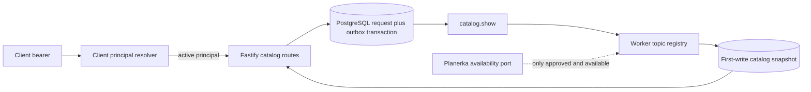

# Architecture Spine — MVP Client Catalog 001

## Design Paradigm

The API is a command/read edge, PostgreSQL owns request and immutable snapshot state,
and the worker owns `catalog.show` materialization. Provider capability is a disabled
optional read port, not an HTTP concern.

## Invariants & Rules

### AD-1 — Request transaction owns the durable intent

- **Binds:** CAP-1, application request service, PostgreSQL request repository.
- **Prevents:** an API success without an outbox fact or duplicate user-scoped requests.
- **Rule:** Insert/replay `client_catalog_requests` and request-origin `catalog.show` in
  one serializable transaction keyed by `(user_id, request_digest)`; its deterministic
  outbox idempotency/reconciliation/hash facts derive from immutable request ID, not
  correlation context.

### AD-2 — Worker owns first-write snapshot materialization

- **Binds:** CAP-2, outbox dispatcher, snapshot repository.
- **Prevents:** HTTP-triggered provider work and a changing response after ready.
- **Rule:** The `catalog.show` handler recognizes strict legacy/new payload variants and
  inserts a snapshot only while its request is pending; ready rows are read unchanged.

### AD-3 — Local catalog facts and availability are separate authorities

- **Binds:** CAP-2, catalog repositories, Planerka adapter seam.
- **Prevents:** a disabled/unverified Planerka adapter from fabricating or leaking slots.
- **Rule:** PostgreSQL selects public active/verified expert-services; an availability
  result is usable only when complete and observed within 15 minutes of database `now`,
  starts 24 hours ahead and has known capacity. Otherwise each card is `catalog_only` with
  an empty array.

### AD-4 — Client principal is the only read authority

- **Binds:** CAP-1, HTTP route, client principal resolver, request repository.
- **Prevents:** body-supplied ownership and request enumeration.
- **Rule:** Resolver output is validated before any access; reads filter by both request
  UUID and `principal.userId`, mapping absent/foreign/expired to identical `404`.

### AD-5 — Payload compatibility is explicit and feature-gated

- **Binds:** CAP-1, CAP-2, worker topic registry, runtime config.
- **Prevents:** breaking conversation `catalog.show` and dispatching an unregistered topic.
- **Rule:** Register/claim no handler until both default-false flags are true; then retain
  the existing conversation payload exactly as one strict branch and add only
  `{v:1,catalogRequestId}` as the request branch.

### AD-6 — Snapshot facts are minimised and disposable

- **Binds:** CAP-3, migration, privacy export/erasure, metrics.
- **Prevents:** durable contact/provider/raw data and retention beyond 24 hours.
- **Rule:** Store and return public display/service/language, availability mode and starts
  only; expiry locks request/outbox, strips snapshot and filters at 24 hours, and keeps only
  a terminal-outbox tombstone. Subject erasure removes all catalog facts; metrics use fixed
  phase/outcome labels only.

## Consistency Conventions

| Concern | Convention |
| --- | --- |
| Naming | `ClientCatalogRequest`, `CatalogSnapshot`, `catalog.show`, `catalog_only`, `fresh_slots` |
| Data | canonical UUID internally; UTC ISO instants; strict discriminated payload union; SHA-256 digest |
| State | `pending -> ready` or `pending -> expired`; both are terminal. Expiry deletes a ready snapshot without reclassifying it; request creation and outbox are atomic; first ready write wins |
| Errors | API only emits the frozen normalized errors; foreign lookup is `not_found` |
| Configuration | both explicit boolean feature flags default false; missing capability fails composition closed |

## Structural Seed

## Capability → Architecture Map

| Capability | Lives in | Governed by |
| --- | --- | --- |
| CAP-1 | client principal resolver, route, request service/repository | AD-1, AD-4, AD-5 |
| CAP-2 | topic registry, worker handler, public catalog reader, snapshot repository | AD-2, AD-3, AD-5 |
| CAP-3 | retention/erasure repositories, privacy service, metrics | AD-6 |

## Deferred

- Client bearer issuance, revocation and active-state provenance await a reviewed issuer.
- Planerka HTTP/codec/read contract awaits authenticated contract evidence; no adapter is
  inferred from existing local slot tables.
- Booking consumes no catalog ID in this slice; that cross-slice handoff is deferred.
