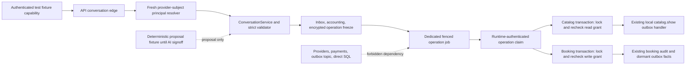

# Architecture Spine — MVP-CLIENT-CONVERSATION-001

## Design Paradigm

Hexagonal application core with durable local orchestration. An ordered-header authenticated
capability and PostgreSQL binding resolver are inbound adapters; `ConversationService` validates
and atomically freezes strict operations; a dedicated fenced job presents a runtime-authenticated
claim and the catalog/booking transaction freshly locks/rechecks exact tool authority. Provider,
outbox-registry, database, and financial
adapters are never exposed to the intent engine.

## Invariants & Rules

### AD-1 — Authenticated capability is the only edge

- **Binds:** CAP-1, CCV-001, CCV-002, API composition
- **Prevents:** raw webhook fields, fixtures, or configuration from becoming internal user authority
- **Rule:** Runtime code may call conversation only with the exact closed result of an injected `AuthenticatedConversationInboundCapability` consuming ordered `request.raw.rawHeaders` occurrences on a proven HTTP/1.1 boundary; normalized maps, proxy/HTTP2 ambiguity, production fallback and enabled route without the capability are forbidden.

### AD-2 — Composite provider mapping resolves fresh authority

- **Binds:** CAP-1, CCV-003, CCV-004, identity persistence
- **Prevents:** tenant/thread collisions, inactive-user reuse, plaintext identity authority, and confused-deputy UUID injection
- **Rule:** Resolve fixture-v1 provider, tenant and subject tokens only from `provider_subject_mappings` joined freshly to `users.active=true`; identity is not tool scope. Never consult `channel_identities`, inbound UUIDs, cached principals, structural casts or fallback creation.

### AD-3 — Completion freezes one operation before mutation

- **Binds:** CAP-2, CCV-005, CCV-006, CCV-010
- **Prevents:** double claims, changed-payload replay, nondeterministic reinference after a crash, split accounting, and downstream duplication
- **Rule:** Use the existing inbox/message completion lock and exact payload digest. For tools, the first serializable completion atomically writes accounting plus one encrypted `client_conversation_operations` row unique by message event before any tool call; duplicates load the frozen outcome and no second inbox is added.

### AD-4 — Runtime claim and serialized grant own every tool mutation

- **Binds:** CAP-3, CAP-4, CCV-007, CCV-010
- **Prevents:** LLM/database authority, generic command smuggling, direct financial/provider mutation, and parallel catalog/booking stores
- **Rule:** The repository privately mints a native-private-field/WeakSet claim bound to one fence/tool/scope/input. The service calls the ordinary repository's exact prelock helper (catalog `userId:requestDigest`; booking `choice:choiceDigest`), then locks `users -> mapping -> exact grant -> operation`, rechecks, and takes remaining locks. Lifecycle starts at `users` and never waits for a tool prelock, so no inverse edge exists and first commit wins. No caller reconstructs lock bytes; structural/cross-tool claims never authorize booking.

### AD-5 — Dedicated operation job is not an outbox/provider handler

- **Binds:** CAP-5, CCV-011, worker composition
- **Prevents:** a docs/tool change silently activating Selarti, Planerka, Telegram, billing, or blind after-write retry
- **Rule:** Claim frozen operations through their own table, expiry-capped five-minute fenced lease and bounded reconciliation; never add an integration-outbox topic. Only existing local `catalog.show` is tool-related in the registry. Existing dormant `selarti.send`/`client.no_package` rows gain no handler; booking-provider topics remain absent. Local or delivery ambiguity is never blind retry or billing evidence.

### AD-6 — Capability matrices fail before state

- **Binds:** CAP-5, CCV-001, CCV-014, API and worker startup
- **Prevents:** partial enablement, migration-before-validation, missing service fallback, and implicit provider/AI activation
- **Rule:** API and worker preflight validate only local flag/dependency implications. Running dispatch/cleanup jobs publish compatible DB-time leases for the exact build; deployment readiness and each tool freeze require both, and lease loss withdraws readiness. No process-local check claims cross-process presence. All new and provider/AI flags default false.

### AD-7 — Security and privacy envelopes are fixed

- **Binds:** CCV-005, CCV-012, CCV-013, CCV-017
- **Prevents:** unbounded attack cost, replay outside authority, raw content retention, identifier telemetry, and AI release by green test
- **Rule:** Enforce exact raw-header, payload-digest, byte/time/rate/error/metric rules; accept fixture key version 1 only; encrypt operations with AES-256-GCM v1, unique nonce, exact AAD and bounded key lifecycle; at expiry fence all owners and transactionally write `privacy_expired`, clear crypto and create one case/receipt; require incident regressions, prior-release distribution diff, and named Product/Safety/Security signoff because this is an AI tool-schema change.

### AD-8 — One total focused release gate

- **Binds:** CCV-015, CCV-016, implementation and release evidence
- **Prevents:** invented migration numbers, repeated local evidence, partial gate success, and test evidence being treated as activation
- **Rule:** After booking merges, allocate one migration using only the next actual prefix for tenant binding, grants and durable operations. Development tests may repeat without Claw/PG; after closure review, one immutable release invocation is total for its reviewed SHA/identity and a failure blocks without silent rerun.



## Consistency Conventions

| Concern | Convention |
| --- | --- |
| Names | `ClientConversation*` for application types; `CCV-*` requirements; provider mapping literal `selarti.client-thread.v1` |
| Identifiers | Canonical internal IDs are lowercase UUIDs; provider subjects/events/messages are exact versioned HMAC tokens; booking choice is exact `ch1` handle |
| Inputs | Exact closed objects, strict UTF-8, no normalization of provider bytes, database time for durable state |
| Errors | Closed internal unions; fixed credential-free HTTP bodies; dependency failure never becomes authority denial or fallback |
| State | Message completion freezes accounting plus one encrypted operation; fenced local job and downstream server identities own replay |
| Logging | Fixed operation/outcome only; raw payload/content/identity/token/UUID/handle/filter and free text forbidden |
| Configuration | Every new/live/AI/provider flag is explicit boolean false by default; local preflight plus cross-process DB leases before route exposure/tool freeze |

## Stack

Repository-pinned or repository-declared versions inspected at the exact base; no new dependency is introduced.

| Name | Version |
| --- | --- |
| Node.js | >=24 <25 |
| pnpm | 11.9.0 |
| TypeScript | 5.8.3 range `^5.8.3` |
| Fastify | 5.5.0 range `^5.5.0` |
| Drizzle ORM | 0.45.2 range `^0.45.2` |
| PostgreSQL evidence target | 16.15 (`server_version_num=160015`) |

## Structural Seed

```text
apps/api/src/
  routes/selarti-webhook.ts             # strict edge; never supplies userId
  server.ts                             # default-off preflight/composition
packages/application/src/
  client-conversation-authority.ts      # nominal identity plus private runtime operation claim
  conversation-service.ts               # safety, validation, atomic operation freeze
  ports.ts                              # strict inbound/tool service seams
packages/db/src/repositories/
  client-conversation-principal-repository.ts  # exact mapping-to-active-user lookup
  client-conversation-operation-repository.ts  # grants, leases, reconciliation, cleanup
  message-repository.ts                 # inbox/accounting/operation-freeze owner
packages/integrations/src/selarti/
  disabled-selarti-adapter.ts           # remains the only production composition
apps/worker/src/
  client-conversation-operations.ts     # dedicated bounded job, not outbox registry
  client-catalog-outbox.ts              # only existing tool-related outbox handler
```

```mermaid
sequenceDiagram
  participant F as Authenticated fixture
  participant A as API edge
  participant R as Principal resolver
  participant C as ConversationService
  participant I as Integration inbox
  participant T as Typed backend service
  F->>A: authenticated opaque event
  A->>R: provider + subjectToken
  R-->>A: fresh active principal
  A->>C: principal + bounded message
  C->>I: lock event and exact payload hash
  C->>I: atomically freeze encrypted tool + accounting
  I-->>C: first frozen outcome or duplicate
  C-->>A: accepted
  Note over I,T: dedicated fenced job runs asynchronously
  I->>T: runtime claim; lock/recheck exact grant in mutation transaction
  T-->>I: created/replayed receipt digest or unknown
```

## Capability → Architecture Map

| Capability / Area | Lives in | Governed by |
| --- | --- | --- |
| CAP-1 authenticated principal | API capability, principal resolver, provider mappings | AD-1, AD-2, AD-6 |
| CAP-2 replay | message completion plus durable operation repository | AD-3, AD-5, AD-7 |
| CAP-3 catalog | runtime claim plus transactional catalog-read recheck | AD-4, AD-5 |
| CAP-4 booking | runtime claim plus transactional booking-write recheck | AD-4, AD-5 |
| CAP-5 safe operations | local preflight, runtime leases, non-outbox job, runbook/evidence | AD-5, AD-6, AD-7, AD-8 |

## Deferred

- Live Selarti codec/authentication, provider limits, stable delivery identity, sandbox and transport remain deferred until an immutable approved contract exists.
- Live binding/grant enrollment, key rotation/custody and revocation UI remain deferred; fixture version 1 is the only implemented token version.
- Outbound client response rendering/delivery remains deferred; this slice creates no provider handler.
- The required migration prefix is deferred until booking merges and the actual journal is inspected; its schema scope is already fixed by AD-3/4/5/8.
- Production topology and scaling beyond the current API/worker/PostgreSQL deployment remain governed by existing deployment documents and require separate authorization.
