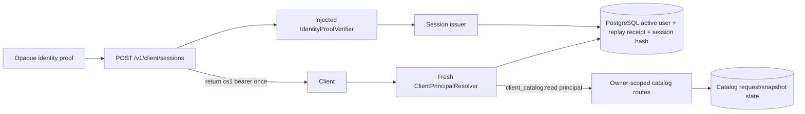

# Architecture Spine — MVP Client Principal 001

## Design Paradigm

The HTTP edge owns strict credential syntax, an injected verifier owns external proof trust,
PostgreSQL owns replay/session state, and a fresh resolver supplies the principal consumed by
the catalog application boundary. No provider adapter or catalog repository may verify proof.

## Inherited Invariants

| Inherited | From parent | Binds here |
| --- | --- | --- |
| Catalog AD-4 | catalog spine at `10819c8` | principal `userId` is the only catalog read authority; foreign/missing remains `404` |
| Catalog AD-5 | catalog spine at `10819c8` | default-off capability composition fails closed and preserves catalog contract |
| Identity source | `packages/db/src/schema/identity.ts` | sessions bind existing canonical `users.id` and recheck `users.active` |
| Session precedent | `admin_sessions` and `PostgresAdminApprovalRepository` | database clock, hash lookup, expiry and revocation are resolved in PostgreSQL |

## Invariants & Rules

### AD-1 — External trust is an injected capability

- **Binds:** CAP-1, CPS-001, CPS-002, API composition and verifier interface.
- **Prevents:** an allow-all test stub, Selarti identifier, or implicit provider client becoming
  production identity authority.
- **Rule:** Session routes register only when `CLIENT_SESSION_ENABLED=true` and a production
  composition supplies the verifier, issuer repository, and resolver; runtime packages export no
  accepted-proof fallback, and missing capability fails startup.

### AD-2 — Issuance transaction is the replay owner

- **Binds:** CAP-1, CAP-3, CPS-003 through CPS-006A, session repository.
- **Prevents:** two sessions from one proof, a bearer returned before commit, or an inactive user
  receiving a session.
- **Rule:** One database transaction checks canonical active `users.id`, proof audience/scope and
  expiry in `(databaseNow, databaseNow + 1 hour]`, uniquely inserts the verifier HMAC replay
  digest, and inserts the linked hashed session with that expiry; unique-replay conflict returns
  no bearer. The receipt has a nullable session link with `ON DELETE SET NULL`; erasure deletes the
  session but retains the non-linkable replay tombstone until proof expiry, when cleanup deletes it.

### AD-3 — Plaintext bearer exists only at the response edge

- **Binds:** CAP-1, CPS-004, CPS-010, issuer service and HTTP serializer.
- **Prevents:** bearer recovery from PostgreSQL, telemetry, retries, or administrative reads.
- **Rule:** Generate exactly 32 random bytes, serialize `cs1.` plus 43 unpadded base64url
  characters once, pass only its `sha256:` digest into persistence, and set no-store response
  headers; no API returns a session token after creation.

### AD-4 — Every request resolves live PostgreSQL authority

- **Binds:** CAP-2, CAP-3, CPS-006 through CPS-009, principal resolver and catalog routes.
- **Prevents:** stale cached access after expiry, revocation, user deactivation, or scope change.
- **Rule:** Count exactly one case-insensitive `Authorization` field in `request.raw.rawHeaders`,
  parse its canonical Bearer value, hash it, and query session plus user using database time on
  every protected request; require unrevoked, unexpired
  `client_catalog:read` and active user before constructing the principal.

### AD-5 — Catalog ownership is principal-derived

- **Binds:** CAP-2, CPS-009, `MVP-CLIENT-CATALOG-001` command/read routes.
- **Prevents:** body-supplied ownership, cross-client enumeration, or catalog enablement with a
  nonfunctional session path.
- **Rule:** Catalog routes consume only resolver `userId`; `CLIENT_CATALOG_ENABLED=true` without
  enabled client sessions and an injected resolver is a startup error, and catalog owner filtering
  plus foreign-or-missing `404` remains unchanged.

### AD-6 — Credential failures are normalized and enumeration-safe

- **Binds:** CAP-1, CAP-2, CPS-003, CPS-006 through CPS-008, HTTP error mapping.
- **Prevents:** callers learning whether a user, proof, token, session, scope, or revocation row
  exists.
- **Rule:** Invalid proof/authority and every negative credential row map to the same `401`; only
  malformed issuance input maps to `400`, and verifier/session-PostgreSQL unavailability maps to
  `503 {"error":"temporarily_unavailable"}` without nested cause or credential material. Catalog
  feature disablement retains its distinct `503 {"error":"feature_disabled"}` amendment branch.

### AD-7 — Session data has no business or provider authority

- **Binds:** CAP-3, CAP-4, CPS-010 through CPS-012, persistence and observability.
- **Prevents:** identity work mutating provider, ledger, reservation, booking, payment, catalog
  filter, or contact state.
- **Rule:** Session persistence contains only hashes, internal user UUID, one fixed scope and
  lifecycle timestamps; erasure removes the user-linked session but retains its non-linkable
  replay receipt until proof expiry. Session code imports no provider/payment/booking repository
  and emits only fixed-label operational telemetry with credential fields redacted before sinks.

### AD-8 — Activation and verification are separate gates

- **Binds:** CAP-4, CPS-013 through CPS-016, migration plan and runbook.
- **Prevents:** a guessed migration number, green test, or available stub being treated as live
  authorization.
- **Rule:** Pure capability preflight runs before migrations. Allocate the next actual migration
  after catalog merge, run exactly one focused Claw invocation for the slice only after local
  review, and retain `CLIENT_SESSION_ENABLED=false` until the Security proof-source checklist and
  a separate deployment approval are recorded.

## Consistency Conventions

| Concern | Convention |
| --- | --- |
| Naming | `ClientSession`, `IdentityProofVerifier`, `ClientPrincipalResolver`, `client_catalog:read`, `client_session:create` |
| Data | canonical UUID; UTC instants; `cs1.` bearer; `sha256:` token digest; `hmac-sha256:` replay digest |
| State | session `active -> revoked` or `active -> expired`; erasure nulls the receipt link and the non-linkable receipt remains until proof expiry, then receipt-first cleanup |
| Errors | issuance `400|401|503`; protected resolution `401|503`; revocation `204|401|503`; no credential reason detail |
| Configuration | `CLIENT_SESSION_ENABLED=false`; catalog true requires session true plus resolver |
| Clock | PostgreSQL `clock_timestamp()` is authoritative for issue, resolve, revoke and cleanup |

## Structural Seed

## Capability → Architecture Map

| Capability | Lives in | Governed by |
| --- | --- | --- |
| CAP-1 | verifier port, issuer service, session repository, issue route | AD-1, AD-2, AD-3, AD-6 |
| CAP-2 | bearer parser, fresh resolver, catalog composition | AD-4, AD-5, AD-6 |
| CAP-3 | session/replay tables, revoke and cleanup operations, redaction | AD-2, AD-4, AD-7 |
| CAP-4 | config composition, migration allocation, review and activation runbook | AD-1, AD-8 |

## Deferred

- `FOLLOW-CLIENT-BOOKING-001` owns a new booking-write scope and protected choice contract; this
  spine must not pre-authorize it with `client_catalog:read`.
- `FOLLOW-SELARTI-IDENTITY-001` owns verified Selarti channel-to-user binding; the existing
  external channel ID must not be reused as an internal UUID or as this proof.
- Identity-proof provider selection, trust keys, rotation, revocation feed, and production SLOs
  remain Security decisions and block activation, not default-off implementation.
- Planerka availability and provider contracts remain outside session architecture.
