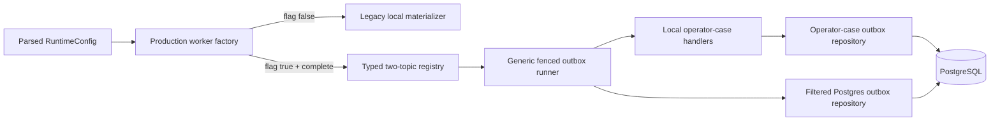

# Architecture Spine — MVP-WORKER-OUTBOX-001

## Design Paradigm

The existing PostgreSQL transactional outbox remains the state owner. A
configuration-derived, closed typed registry adapts exactly two local topics to
idempotent operator-case materialization. The generic runner owns fenced claim
and transition mechanics; topic handlers own decode, local mutation and durable
inspection; application/provider transports are outside the dependency graph.



## Inherited Invariants

| Inherited | From parent | Binds here |
| --- | --- | --- |
| OPS-CASE-001-MAT | `docs/spec/mvp-operator-case-inbox.md` | one privacy-bounded case per source outbox row; concurrent retries do not duplicate |
| OPS-CASE-001-PRIV | `docs/spec/mvp-operator-case-inbox.md` | no feedback text, safety narrative or domain/source identifiers in the case surface |
| Fenced claims | `packages/db/src/repositories/outbox-repository.ts` | owner and claim-token checks guard every dispatch/reconciliation transition |
| Bounded worker cycle | `apps/worker/src/runtime.ts` | one non-overlapping cycle, batch `1..1000`, bounded shutdown |

## Invariants & Rules

### AD-1 — Parsed configuration owns mode selection

- **Binds:** CAP-1, CAP-5; R1, R2, R9
- **Prevents:** an injected prebuilt ingress running while the flag is false, or
  both legacy and generic paths claiming the same rows.
- **Rule:** the production factory receives `RuntimeConfig`, chooses one branch,
  and lazily invokes the registry factory only for `true`. Enabled-incomplete
  composition throws before a claim; false/absent executes the legacy branch.

### AD-2 — The topic set is a closed typed tuple

- **Binds:** CAP-2; R3, R4, R12
- **Prevents:** generic worker activation silently claiming a provider row.
- **Rule:** derive SQL allowlists and registry lookup from one readonly tuple
  containing exactly the two local topic literals. Claim, unknown claim,
  exhaustion and lease recovery all require that tuple. No free-form topic list
  crosses the configuration/composition boundary.

### AD-3 — Payload locates; PostgreSQL authorizes

- **Binds:** CAP-3, CAP-4; R5, R6, R7
- **Prevents:** a forged payload supplying operator-case rating, hash, policy,
  narrative, financial data or recipient authority.
- **Rule:** strict decoders admit the exact companion DTOs. Safety delivery
  requires a matching authoritative handoff ID/version in escalated state and
  fixes case fields by topic. Feedback case fields are read from the
  authoritative feedback row; well-formed mismatched payload metadata cannot
  override or suppress them. Unknown fields and coercion are rejected. Payload
  content is never logged.

### AD-4 — Local mutation and outbox acknowledgement are separated and reconciled

- **Binds:** CAP-3, CAP-4; R8, R10
- **Prevents:** duplicate local mutation after a crash between case insert and
  source-row success, or infinite retry of a poison fact.
- **Rule:** handler mutation is idempotent by outbox ID and does not transition
  outbox state. The runner performs fenced transitions. Reconciliation inspects
  the durable case; terminal results are first-class and fenced, not exceptions
  reclassified as unknown.

### AD-5 — Legacy and generic paths are mutually exclusive

- **Binds:** CAP-1, CAP-5; R9
- **Prevents:** dual consumers, misleading counters and nondeterministic row
  ownership during rollout or rollback.
- **Rule:** false/absent runs the unchanged legacy materializer and existing
  recovery behavior. True delegates registered-topic recovery/reconciliation/
  dispatch to one generic batch and does not call legacy materialization or the
  separate unfiltered recovery job for those rows.

### AD-6 — Telemetry is a bounded port

- **Binds:** CAP-6; R11
- **Prevents:** PII/content leakage and cardinality growth from IDs, hashes,
  exception messages or dynamically discovered topics.
- **Rule:** the runner accepts a typed metrics port. App-worker composition maps
  its closed enums to existing observability instruments. No payload or dynamic
  string becomes a label; absence of a configured exporter is not described as
  production telemetry delivery.

## Consistency Conventions

| Concern | Convention |
| --- | --- |
| Naming | Feature flag `WORKER_OUTBOX_DELIVERY_ENABLED`; capability error `worker_outbox_delivery_capability_unavailable`; requirements `WORKER-OUTBOX-001-Rn` |
| Data | canonical UUID strings; positive safe integers; lowercase SHA-256 hex; exact-object decoding; PostgreSQL clock and claim tokens |
| State | repository owns claim/fencing/status; handler owns local idempotent case mutation; terminal reasons use closed snake_case codes |
| Errors | expected poison/source terminal states are typed outcomes; thrown handler errors are ambiguous until durable reconciliation |
| Logging | no payload, IDs, correlation/reconciliation keys, hashes, policies or exception messages |

## Stack

| Name | Version |
| --- | --- |
| Node.js | `>=24 <25` |
| TypeScript | `^5.8.3` |
| PostgreSQL client | `pg ^8.16.3` |
| Drizzle ORM | `^0.45.2` |
| Vitest | `^3.2.4` |

## Structural Seed

```text
packages/worker/src/
  outbox-runner.ts                         # generic state machine
  local-operator-case-outbox.ts            # typed tuple, decoders, handlers
packages/db/src/repositories/
  outbox-repository.ts                     # allowlisted claims/transitions/recovery
  operator-case-outbox-repository.ts       # idempotent local mutation/inspection
apps/worker/src/
  main.ts                                  # config-derived lazy composition
  runtime.ts                               # mutually exclusive mode selection
packages/config/src/env.ts                 # default-false flag
packages/observability/src/metrics.ts      # bounded instruments/label validators
```

## Capability → Architecture Map

| Capability / Area | Lives in | Governed by |
| --- | --- | --- |
| CAP-1 configuration | config + app-worker factory | AD-1, AD-5 |
| CAP-2 registry/filtering | worker registry + DB outbox repository | AD-2 |
| CAP-3 durable local delivery | runner + operator-case outbox repository | AD-3, AD-4 |
| CAP-4 poison handling | decoders + terminal reconciliation state | AD-3, AD-4 |
| CAP-5 ownership | runtime composition | AD-1, AD-5 |
| CAP-6 metrics | worker metrics port + observability adapter | AD-6 |

## Deferred

- Provider topic handlers and credentials are separate provider stories with
  their own authorization and reconciliation contracts.
- Live metric export, dashboards and alerts require an observability deployment
  story; this feature only emits bounded instruments.
- A topic-prefixed outbox index is deferred until measured query plans prove it
  necessary. Existing bounded claims and indexes are sufficient for this MVP;
  therefore no migration is authorized here.
