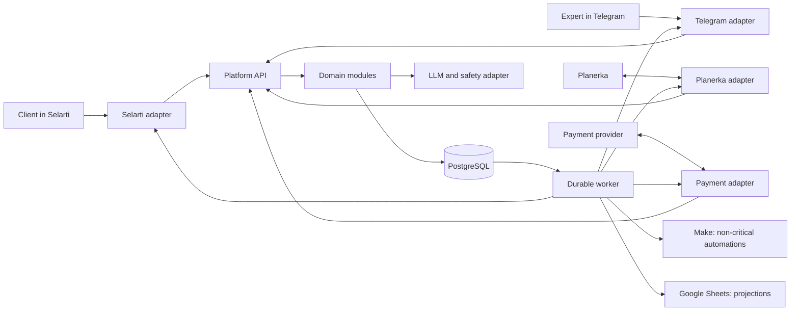
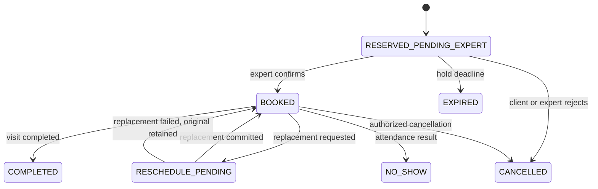

# ии-Тоня Platform — production design

## 1. Purpose and authority

This document is the implementation architecture for the client assistant, expert
Telegram bot, booking, package, coupon, referral, payment, notification, and safety
workflows described in the
[authoritative source snapshot](../../source/ii-tonya-expert-full-source-2026-07-28.txt).

The source is authoritative for product intent and wording, but it contains repeated
drafts, contradictions, pseudo-JSON, invented endpoint examples, and claims about files
that do not exist. It is not executable configuration. This design is authoritative for
system boundaries and production invariants. Unresolved product or provider contracts
are called out as go-live blockers rather than filled in by assumption.

Source line references in this document refer to the 4,470-line snapshot:

- client behavior and commercial rules: lines 20–709;
- proposed Make/Sheets mechanics: lines 711–1050;
- expert prompt and expert mechanics: lines 1061–1468;
- claimed Make JSON: lines 1472–2198;
- self-revision and missing scenarios: lines 2205–2584;
- claimed archive and CSV templates: lines 2585–3025;
- consolidated tables and developer brief: lines 3033–3784;
- expert package and operator guide: lines 3801–4470.

## 2. Architecture paradigm

The platform is a **modular transactional monolith with ports and adapters**:

- one domain model owns commercial and booking state;
- one API process receives synchronous requests and provider webhooks;
- one worker process executes durable jobs and transactional outbox messages;
- PostgreSQL is the only authoritative operational store;
- Selarti, Planerka, Telegram, the payment provider, the LLM provider, Make, and
  Google Sheets are external adapters;
- the LLM may interpret and compose, but it may not directly mutate booking, balance,
  coupon, payment, consent, or safety state.

This shape keeps the initial operational footprint small while preventing business
rules from being split across prompts, Make scenarios, spreadsheets, and provider
dashboards.

## 3. Architecture decisions

### AD-1 — One owner for state transitions

- **Binds:** booking, package, message, coupon, referral, payment, and safety modules.
- **Prevents:** two scenarios independently choosing incompatible states or balances.
- **Rule:** only the domain service may commit a state transition. Provider adapters,
  prompts, Make, and Sheets submit commands or events and receive results.

### AD-2 — PostgreSQL is the system of record

- **Binds:** all operational data and audit history.
- **Prevents:** overbooking, lost increments, spreadsheet races, and balances drifting
  between `messages_used` and `messages_available`.
- **Rule:** Sheets and Make never originate authoritative balance, seat, payment, or
  reservation state.

### AD-3 — Append-only commercial ledgers

- **Binds:** message packages, coupon grants/redemptions, payments, refunds, referrals.
- **Prevents:** destructive balance edits and unverifiable refunds.
- **Rule:** balances are derived from immutable ledger entries. Corrections are new
  compensating entries, never edits to historical entries.

### AD-4 — Idempotent inbox and transactional outbox

- **Binds:** every external webhook and every outgoing provider call.
- **Prevents:** Make/provider retries causing duplicate charges, bookings, refunds, or
  notifications.
- **Rule:** an incoming provider event is accepted once by `(provider, external_event_id)`;
  domain changes and outbox creation commit in one database transaction.

### AD-5 — Deterministic tools around the LLM

- **Binds:** Selarti conversation handling, expert lookup, recommendations, safety.
- **Prevents:** a model inventing prices, slots, balances, bookings, or emergency actions.
- **Rule:** the model receives the minimum required context and returns a schema-validated
  response or tool request. Tools validate authorization and domain invariants again.

### AD-6 — Split scheduling ownership explicitly

- **Binds:** Planerka and booking modules.
- **Prevents:** a local reservation and a Planerka booking both claiming authority.
- **Rule:** Planerka is the authority for calendar availability and meeting metadata;
  the platform is the authority for commercial reservation state, expert approval,
  waitlist position, coupons, and payment. The exact provisional-hold operation is a
  live-contract blocker.

### AD-7 — Make and Sheets are projections

- **Binds:** operations dashboards, administrator notifications, exports.
- **Prevents:** non-transactional automation becoming a hidden second backend.
- **Rule:** Make consumes signed platform events. Sheets is rebuilt from the platform and
  may be stale without affecting client-visible truth.

### AD-8 — Sensitive data is minimized and scoped

- **Binds:** client profiles, conversations, expert access, safety incidents, analytics.
- **Prevents:** the broad profile requested at source lines 66–86 and raw dialog logging
  at lines 3120–3129 from becoming unrestricted shared data.
- **Rule:** every sensitive field has purpose, provenance, consent, retention, and an
  access policy. Expert views contain only data needed for that expert's active booking.

### AD-9 — Live changes pass through staging and shadow modes

- **Binds:** all provider adapters and financial/safety behavior.
- **Prevents:** an unverified provider contract reaching real clients.
- **Rule:** no adapter is enabled for live mutation until its contract tests,
  reconciliation, rollback, and operational alerts pass in staging.

## 4. Modules and boundaries

| Module                | Owns                                                                      | May call                                  | Must not own                                      |
| --------------------- | ------------------------------------------------------------------------- | ----------------------------------------- | ------------------------------------------------- |
| Identity and consent  | clients, external identities, contact verification, consent               | audit, provider identity resolution       | booking or financial balances                     |
| Client profile        | explicitly collected preferences and request summaries                    | consent, encryption, LLM context builder  | inferred diagnosis or unrestricted dialog history |
| Catalog               | experts, services, formats, prices, eligibility metadata                  | Planerka reference mapping                | live availability                                 |
| Scheduling            | normalized Planerka availability and meeting metadata                     | Planerka adapter                          | coupons or package balances                       |
| Booking               | reservation state machine, capacity, reschedule, waitlist                 | scheduling, billing authorization, outbox | provider-specific status strings                  |
| Messaging packages    | package grants and per-message ledger                                     | payment, conversation delivery events     | mutable cached balance as truth                   |
| Coupons and referrals | coupon grants, expiry, redemption, reversal, referral qualification       | payment and booking                       | payment-provider transaction state                |
| Payments              | orders, provider events, settlement, refund, chargeback, reconciliation   | package/coupon grant commands             | direct client messaging                           |
| Conversation          | conversations, provider messages, prompt versions, delivery state         | LLM, safety, package metering             | commercial mutations outside typed commands       |
| Safety                | deterministic triage, approved response, human escalation, incident audit | conversation and operator notification    | autonomous medical diagnosis                      |
| Notification          | templates, delivery attempts, reminders, quiet periods                    | outbox and channel adapters               | deciding domain transitions                       |
| Integration           | inbox, outbox, provider cursors, dead letters, reconciliation             | all adapters                              | product policy                                    |
| Projection            | Make events, Sheets views, analytics extracts                             | integration outbox                        | authoritative writes                              |
| Audit and operations  | actor/action trail, support tools, feature flags, kill switches           | all modules                               | silent data repair                                |

Cross-module calls use commands and immutable events. Modules do not update another
module's tables directly.

## 5. Core data flows

### 5.1 Client message

1. Selarti sends a verified event containing a stable message ID, thread/external
   identity, direction, timestamp, and content reference.
2. The integration inbox deduplicates the event and resolves it to a client.
3. The metering policy records at most one debit for the accepted inbound or delivered
   outbound message.
4. The conversation module runs deterministic package and safety gates.
5. The LLM receives only approved context and returns text plus optional typed tool calls.
6. Domain tools execute independently of the model and enqueue the response in the outbox.
7. The Selarti adapter sends it; delivery outcome becomes a new inbox event.

The source requires every inbound and outbound message to consume one unit
(lines 417–452), but the pseudo-scenarios also debit outgoing messages manually
(lines 837–842, 871–874, 944–948), which would double-charge them. Production metering
therefore keys each debit to one provider message ID and one direction.

The zero-balance blocking message remains a product decision. It must be represented as a
non-recursive control delivery; otherwise the outgoing webhook described at lines 791–805
can trigger itself indefinitely.

### 5.2 Reservation and expert approval

1. The platform reads normalized future availability from the Planerka adapter.
2. The client selects a service instance; the API creates one idempotent reservation
   command.
3. In one transaction the booking module checks client eligibility, duplicate active
   reservations, capacity, booking horizon, and any authorized coupon/payment amount.
4. It creates `RESERVED_PENDING_EXPERT`, appends a booking event, and queues:
   provisional Planerka synchronization, client acknowledgement, and expert notification.
5. Telegram sends a signed callback token bound to reservation, expert, intended action,
   and expiry.
6. Expert confirmation transitions the reservation to `BOOKED`; rejection transitions it
   to a cancellation reason. Provider updates and notifications leave through the outbox.
7. An expiry job uses a compare-and-set transition, releases capacity once, and offers the
   place to the oldest eligible waitlist entry.

The source combines a minimum 24-hour slot horizon with a 72-hour hold
(lines 307–331). A slot 25–72 hours away could start before its hold expires. No live
booking is allowed until product policy chooses either a shorter hold or a larger booking
horizon.

### 5.3 Reschedule

Reschedule is a saga, not “cancel then try” as in source lines 1953–1981:

1. validate and reserve the replacement instance;
2. synchronize the replacement with Planerka;
3. atomically link old and replacement reservations;
4. cancel the old reservation only after replacement success;
5. compensate the replacement if the old reservation cannot be closed;
6. notify client and expert from committed outbox messages.

### 5.4 Waitlist promotion

Waitlist order is determined by immutable enqueue time plus ID, not a mutable `position`.
Promotion re-runs package, consent, duplicate, capacity, event-time, and payment checks.
An offer has its own expiry and does not charge coupons or money before explicit
authorization.

### 5.5 Payment and entitlement

The source mentions payment, coupon rewards, referral rewards, and refunds
(lines 130–173) but provides no payment scenario. Production flow is:

1. create an internal payment order with an idempotency key and amount in minor units;
2. create provider checkout/invoice;
3. verify and deduplicate the provider webhook;
4. record settlement in the payment ledger;
5. grant the message package and coupons in the same domain transaction;
6. reverse grants with explicit ledger entries on refund/chargeback;
7. reconcile provider settlement reports to local events.

No package or coupon is granted from a client redirect alone.

## 6. State machines

### 6.1 Reservation

`CANCELLED` carries a reason: client, expert, automatic expiry, provider conflict,
payment failure, administrator correction. Historical transitions are immutable.

### 6.2 Waitlist

`QUEUED → OFFERED → PROMOTED` with terminal `WITHDRAWN` or `OFFER_EXPIRED`.
Only one active entry per client/event instance is allowed.

### 6.3 Package and message entitlement

`PENDING_PAYMENT → ACTIVE → DEPLETED | EXPIRED`, with `REVOKED` or `REFUNDED` represented
by compensating ledger entries. Consumption always selects the active package with the
earliest expiry, as required at source lines 439–478.

### 6.4 Coupon grant

`AVAILABLE → PARTIALLY_REDEEMED → REDEEMED`, with terminal `EXPIRED` or `REVOKED`.
Cancellation/refund behavior is not enabled until product and legal rules are approved.

### 6.5 Payment

`CREATED → PENDING → SUCCEEDED`, with terminal `FAILED` or `CANCELLED`; a succeeded
payment may become `PARTIALLY_REFUNDED`, `REFUNDED`, or `CHARGEBACK`.

## 7. PostgreSQL schema domains

All identifiers are UUIDs internally. Provider identifiers are stored separately.
Timestamps are `timestamptz` in UTC; client and expert time zones are explicit. Money is
integer minor units plus ISO currency. Sensitive columns are encrypted or tokenized.

### 7.1 Identity and consent

- `clients`
- `client_external_identities(provider, external_id, client_id)`
- `client_contacts`
- `client_consents(type, policy_version, granted_at, withdrawn_at)`
- `client_profile_attributes(purpose, source, confidence, consent_id, retention_until)`

Automatic guesses about gender, social status, children, or health are never treated as
verified profile data.

### 7.2 Experts, catalog, and scheduling

- `experts`
- `expert_channel_accounts(provider, immutable_user_id, immutable_chat_id)`
- `services(expert_id, format, duration, price_minor, currency)`
- `event_instances(service_id, starts_at, ends_at, capacity)`
- `provider_references(provider, entity_type, entity_id, external_id, external_version)`
- `availability_snapshots(provider_cursor, observed_at)`

This resolves the source mismatch where `Events` exposes only `event_id`
(lines 750–755) while workflows query `event_instance_id` (lines 857–870).

### 7.3 Booking

- `reservations(client_id, event_instance_id, state, hold_expires_at, version)`
- `reservation_events(reservation_id, from_state, to_state, reason, actor, occurred_at)`
- `reservation_links(old_reservation_id, replacement_reservation_id, relation)`
- `waitlist_entries(client_id, event_instance_id, state, enqueued_at, offer_expires_at)`

Constraints:

- one active reservation per client/event instance;
- one active waitlist entry per client/event instance;
- state updates require the expected version;
- capacity is checked under a database lock;
- seat count is derived from active reservations, not a mutable `current_seats`.

### 7.4 Packages, coupons, referrals, and payments

- `package_products`
- `package_grants(client_id, starts_at, expires_at, source_payment_id)`
- `message_ledger(client_id, package_grant_id, units, reason, provider_message_id)`
- `coupon_grants(client_id, units, issued_at, expires_at, source_type, source_id)`
- `coupon_ledger(client_id, coupon_grant_id, units, reason, reservation_id)`
- `referral_codes`
- `referral_uses(inviter_id, invitee_id, qualifying_payment_id, state)`
- `payment_orders`
- `payment_events(provider, external_event_id, type, amount_minor, currency)`
- `refunds`

`messages_available`, `coupons_available`, and `current_seats` may exist in read models,
but never as independently editable truth.

### 7.5 Conversation, safety, and audit

- `conversations`
- `conversation_messages(provider_message_id, direction, delivery_state, content_ref)`
- `prompt_versions(channel, version, content_hash, activated_at)`
- `safety_incidents(category, severity, detected_at, response_template_version)`
- `human_escalations`
- `audit_log(actor_type, actor_id, action, target_type, target_id, metadata)`

Full message text is not copied to Google Sheets. Retention and deletion operate on
content separately from immutable financial and audit facts.

### 7.6 Integration reliability

- `integration_inbox(provider, external_event_id, received_at, payload_hash, state)`
- `outbox_messages(topic, aggregate_id, payload, available_at, attempt_count, state)`
- `delivery_attempts`
- `dead_letters`
- `provider_cursors`
- `reconciliation_runs`
- `reconciliation_mismatches`
- `projection_checkpoints`

## 8. Inbox, outbox, and job execution

### Inbox

1. Authenticate the provider request before parsing business data.
2. Store event metadata and payload hash.
3. Insert with a unique provider event key.
4. Return provider acknowledgement only after durable acceptance.
5. Process duplicate events as successful no-ops.
6. Quarantine payloads that fail schema or identity resolution.

### Outbox

1. Commit domain state and the intended external action together.
2. Claim jobs with leases so multiple workers cannot execute the same attempt.
3. Pass an idempotency key to providers that support it.
4. Record response metadata without secrets or full sensitive content.
5. Retry transient errors with bounded exponential backoff and jitter.
6. Send exhausted or permanent failures to a dead-letter queue and alert operations.

### Scheduled jobs

- expire reservations and waitlist offers;
- send booking reminders at the source-defined offsets of two days, one day, and one hour
  (lines 401–408);
- send one package/coupon expiry reminder at the approved offset;
- start post-visit feedback and quiet-period workflows;
- reconcile Planerka, payments, delivery outcomes, and projections;
- enforce retention and deletion;
- detect stuck inbox/outbox entries.

Scheduled jobs emit the same domain commands as synchronous requests; they do not update
tables directly.

## 9. Provider adapters

Each adapter translates between a versioned provider contract and provider-neutral domain
commands/events. No provider field name or status leaks into domain tables.

### Selarti

Required capabilities:

- authenticate and ingest message events;
- map thread/external ID to client identity;
- fetch thread context only when needed;
- send text, buttons, and links;
- expose stable message IDs and delivery outcome if available;
- pass typed platform tool results back to the conversation.

The source invents events such as `message_received_or_sent`, `slot_selected`,
`waitlist_request`, `client_cancel`, and `feedback_received` in lines 1512–2156. These
are contract hypotheses, not accepted API facts.

### Planerka

Required capabilities:

- list normalized availability;
- obtain immutable booking/slot references and meeting metadata;
- create or represent a provisional hold if the live API supports it;
- confirm, cancel, and reschedule;
- ingest signed booking webhooks;
- retrieve current state for reconciliation.

The base URL and endpoints proposed at lines 3358–3410 are rejected until verified
against the authenticated live documentation. Domain states are not assumed to equal
Planerka UI labels.

### Telegram expert bot

Required capabilities:

- verify the Telegram webhook secret and deduplicate `update_id`;
- bind numeric Telegram user/chat IDs to one authorized expert;
- send booking cards with callback tokens;
- answer callbacks promptly and edit stale keyboards;
- implement `/schedule`, `/client`, and `/stats` through authorized platform queries.

The keyboard at lines 4231–4246 is a visual seed only. Its callbacks contain only
`confirm`, `cancel`, or `reschedule`, while the claimed handler expects reservation and
client fields at lines 1873–1880. Production callback data carries an opaque signed
reference and never trusts client-supplied expert or reservation IDs.

### Payment provider

The selected payment provider is **YooKassa by YooMoney** (`PAY-PROV-001`). T-Bank is
not a target provider. Domain contracts remain provider-neutral; a live YooKassa adapter
must remain disabled until its merchant, fiscal, webhook, refund, chargeback,
reconciliation, credential, and operational contracts are independently approved. The
adapter must support:

- checkout/invoice creation;
- webhook authenticity;
- idempotent payment status;
- refunds and chargebacks;
- fiscal receipt metadata where applicable;
- settlement reconciliation and sandbox mode.

### LLM and safety

The LLM adapter supports schema-constrained output, model/version logging, timeout and
fallback, content minimization, and prompt versioning. Safety keyword/model detection can
raise a signal, but approved deterministic crisis copy and human escalation take
precedence. Phone numbers and follow-up rules at source lines 514–532 require current
medical/legal review before activation.

### Make and Google Sheets

The projection adapter emits sanitized events to Make and materializes Sheets views.
Make failures never roll back a booking or payment. A projection can be truncated and
rebuilt from PostgreSQL plus checkpoints.

## 10. Rejected pseudo-artifacts

The following source material must not be copied into deployment:

| Source                                         | Rejection                                                                                                       | Reusable portion                        |
| ---------------------------------------------- | --------------------------------------------------------------------------------------------------------------- | --------------------------------------- |
| “8 ready Make JSON scenarios,” lines 1512–2156 | Valid generic JSON but not Make blueprint schema; no real modules, mappings, routes, connections, or scheduling | workflow names and acceptance intent    |
| Added scenarios, lines 2376–2537               | Same pseudo-schema; coupon block at lines 2490–2537 is not valid JSON because it has two root objects           | event fields and coupon decision points |
| Duplicate expert scenario, lines 4100–4222     | Generic JSON repeated from earlier draft, not importable                                                        | expert action cases                     |
| “13 scenario ZIP,” lines 2585–3025             | No archive exists; source explicitly says it cannot create one, and prompt files are placeholders               | proposed folder naming only             |
| Planerka/Selarti examples, lines 3358–3410     | Unverified domains, endpoints, event names, and Stripe-like placeholder keys                                    | list of required capabilities           |
| Eight-sheet schema, lines 3033–3187            | Missing keys and transactional constraints; duplicates derived balances; stores sensitive dialogs               | column vocabulary for projections       |
| Telegram keyboard, lines 4231–4246             | Lacks reservation context and authorization; callback action alone is unsafe                                    | labels and layout                       |
| Client/expert prompts                          | Contain contradictions and high-stakes instructions; cannot mutate data by themselves                           | tone, prohibited wording, UX templates  |

Machine validation of the source found 19 fenced JSON blocks: 18 are syntactically valid
and one, the coupon block, is invalid. Syntactic validity does not make the remaining
workflow objects Make blueprints.

## 11. Make and Sheets projection contract

Allowed Make use cases:

- notify administrators about negative feedback or dead letters;
- copy approved catalog imports into a review queue;
- deliver non-critical internal summaries;
- connect downstream CRM/analytics after platform events are committed.

Allowed Sheets use cases:

- sanitized expert and service catalog editing with validation/import workflow;
- operational read models for reservations, waitlist, package summary, and aggregate logs;
- controlled CSV export.

Forbidden uses:

- incrementing/decrementing seats, messages, coupons, or money;
- determining whether a payment succeeded;
- executing reservation state transitions;
- storing unrestricted client conversations or crisis content;
- manually editing an authoritative identifier or balance;
- using Sheets row order as waitlist order.

Every projection row includes platform ID, source version, projected timestamp, and
read-only warning. Catalog edits are imported as reviewed commands rather than treated as
instant truth.

## 12. Error handling and reconciliation

Errors are classified as:

- **transient:** timeout, provider 429/5xx, temporary network failure — retry;
- **permanent:** invalid credentials, rejected schema, forbidden action — dead-letter;
- **conflict:** stale reservation version, capacity exhausted — return domain result;
- **unknown outcome:** request timed out after provider may have committed — reconcile
  before retrying the mutation.

Reconciliation jobs:

- compare active local reservations with Planerka references and statuses;
- compare payment orders, provider events, refunds, and settlement totals;
- verify each delivered Selarti message has zero or one matching meter entry;
- verify ledger sums and expiry boundaries;
- detect negative capacity, duplicate active reservations, and stuck holds;
- rebuild and checksum Make/Sheets projections;
- surface mismatches for explicit operator resolution with an audit entry.

Repairs are commands with actor, reason, before/after evidence, and compensating ledger
entries. Operators never edit production rows directly.

## 13. Privacy, safety, and authorization

- Collect only profile fields required for a declared service purpose.
- Do not infer protected or sensitive attributes as facts.
- Require explicit consent for proactive check-ins, marketing-like announcements, and
  processing health-related content.
- Separate contact, conversation, commercial, and safety retention policies.
- Encrypt sensitive data at rest and all provider traffic in transit.
- Redact message text, tokens, phone numbers, email, payment metadata, and crisis content
  from logs and metrics.
- Enforce expert ownership in every query; `/client {name}` is replaced by selection from
  that expert's active reservations.
- Use least-privilege service accounts and rotate provider credentials.
- Maintain user export, correction, deletion, and consent-withdrawal workflows.
- Require a reviewed human escalation protocol before enabling crisis follow-ups.

## 14. Observability

Every request, event, job, provider call, and domain transition carries:

- correlation ID;
- causation ID;
- aggregate ID;
- provider event/message ID where available;
- prompt and policy version where an LLM is used.

### Logs and traces

- structured JSON logs with PII redaction;
- distributed traces across API, database transaction, worker, and provider call;
- immutable audit events for sensitive reads and all mutations;
- no secrets, raw authorization headers, or full crisis/client text.

### Metrics

- inbox acceptance, duplicate, schema-failure, and processing lag;
- outbox age, retry count, dead-letter count, and provider latency/error rate;
- reservation conflicts, expiry lag, reconciliation mismatches, and prevented overbooking;
- message debit counts by direction and invariant violations;
- payment/refund mismatch and unsettled-order age;
- projection lag;
- safety escalation count by category without message content.

### Alerts and dashboards

Page on payment mismatch, capacity invariant failure, persistent provider outage, old
outbox messages, failed safety delivery, or failed backup. Ticket on projection lag,
non-critical Make failure, or isolated dead letter.

## 15. Testing strategy

### Unit and property tests

- every allowed and rejected state transition;
- earliest-expiring package selection;
- ledger conservation under debit, expiry, refund, and compensation;
- coupon expiry and reversal;
- callback authorization and expiry;
- reminder deduplication and quiet-period rules;
- PII redaction and consent gates.

Property tests must prove balances cannot become inconsistent and capacity cannot be
exceeded under generated command sequences.

### Database and concurrency tests

- migrations from an empty database and from the previous release;
- simultaneous reservation attempts for the last seat;
- repeated and out-of-order webhooks;
- worker crash after domain commit but before provider call;
- provider timeout with unknown outcome;
- waitlist promotion races;
- reschedule compensation.

### Provider contract tests

Each adapter has captured, sanitized fixtures for success, duplicate, retry, invalid
signature, rate limit, timeout, and changed-schema cases. Staging runs live sandbox
contract tests before deployment. A provider feature not represented by a fixture remains
disabled.

### Prompt and safety tests

- golden tests for prohibited advertising and medical/legal claims;
- tool-call schema and authorization failures;
- prompt injection against client-provided and catalog content;
- crisis phrases, false positives, fallback copy, and human escalation;
- no fabricated expert, price, balance, slot, or booking.

### End-to-end tests

Staging covers:

1. inbound and outbound message metering without duplicate debit;
2. reserve, expert confirm, reminders, and completion;
3. expert cancel and client cancel;
4. expired hold and waitlist offer;
5. reschedule success and compensation;
6. payment success, refund, and replayed webhook;
7. package/coupon expiry;
8. provider outage, recovery, and reconciliation;
9. Make/Sheets projection rebuild;
10. safety escalation with test identities only.

## 16. CI/CD

GitHub Actions are not used. All mandatory commands are launched directly on Claw with
an explicit source root and exact Git SHA; GitHub is only the Git/PR store. The Claw
container imitates the dedicated server runtime while production remains native.

### Pull request pipeline

1. formatting, linting, type checking, and documentation link checks;
2. unit/property tests;
3. PostgreSQL integration and migration tests;
4. provider contract tests against fixtures;
5. API/schema compatibility checks;
6. secret scanning, SAST, dependency/license checks, and source/dependency SBOM;
7. deterministic dev/test container build pinned by lockfile and base-image digest;
8. deterministic native production-bundle build and executable import/start smoke.

### Main branch release gate

1. sign and publish one immutable native API/worker release bundle;
2. apply migrations to an isolated native staging copy;
3. deploy the bundle to native staging with sandbox providers;
4. run smoke, end-to-end, reconciliation, backup, and restore tests;
5. retain evidence and require explicit production approval.

### Production release

- dedicated Linux server; no application containers or production Docker dependency;
- Node.js 24 API and worker as separate non-root systemd services;
- system PostgreSQL and nginx/TLS on the same dedicated host;
- signed immutable bundle with atomic `releases/<sha>` and `current` symlink switch;
- expand/contract database migrations;
- systemd restart with readiness gate and rollback to the prior compatible bundle;
- migration and adapter kill switches;
- canary traffic limited to approved internal/test identities;
- automatic rollback on health, invariant, or reconciliation failure;
- no rollback that attempts to reverse an already committed payment or booking without
  a compensating domain command.

## 17. Environments and live staging rollout

### Local

- PostgreSQL plus API and worker, optionally under Docker/Compose;
- deterministic fake clock;
- mock Selarti, Planerka, Telegram, payment, LLM, Make, and Sheets adapters;
- synthetic data only.

### CI

- direct Claw execution in ephemeral containerized database and test runtimes that
  imitate the dedicated server;
- recorded provider fixtures;
- no network dependency for required tests.

### Staging

- production-equivalent native systemd topology and migrations without application
  containers;
- provider sandbox or dedicated test accounts;
- allowlisted Telegram experts and Selarti clients;
- test payment instruments only;
- sanitized projection workbooks;
- real alert routing to the delivery team.

### Production rollout sequence

1. **Observe:** ingest and validate provider events without domain mutations.
2. **Shadow:** compute proposed transitions and compare them with provider/manual outcomes.
3. **Projection-only:** publish sanitized Make/Sheets views.
4. **Internal write cohort:** enable booking for allowlisted team accounts; payments off.
5. **Commercial sandbox cohort:** enable provider test payments and refunds.
6. **Limited live cohort:** enable real booking/payment for a small approved cohort with
   manual reconciliation.
7. **General availability:** expand only after all go-live gates remain green.

Feature flags independently disable message metering, booking mutation, coupon use,
payments, proactive messages, LLM tool calls, and safety follow-ups.

## 18. Go-live gates

All are mandatory:

- live Selarti event/delivery contract documented and tested;
- live Planerka availability, hold, confirmation, cancellation, reschedule, webhook, and
  reconciliation contract documented and tested;
- YooKassa merchant and API contracts, fiscal flow, refund, and chargeback behavior
  approved;
- 24-hour visibility versus 72-hour hold contradiction resolved;
- zero-balance control-message and failed-delivery charging policy resolved;
- coupon application limits, cancellation, refund, and referral reversal approved;
- no duplicate debit or booking under replay/concurrency tests;
- expert authorization prevents cross-expert client access;
- data protection, consent, retention, and provider transfer assessment approved;
- crisis contacts, deterministic copy, human ownership, and escalation SLA approved;
- dashboards, alerts, dead-letter runbook, backup, and restore drill pass;
- reconciliation reports zero unexplained financial or booking mismatches.

## 19. Deferred decisions and open questions

### Blocking

- Which exact Selarti webhook and tool/function contracts are enabled for this account?
- Can Planerka create a provisional hold, and what are its real status and idempotency
  semantics?
- Which legal entity and YooKassa merchant account own checkout, receipts, refunds, and
  disputes, and which exact YooKassa API/webhook contract version is approved?
- Is the expert approval SLA 24 hours or 72 hours, and what booking horizon makes it safe?
- Is a zero-balance blocking message charged, and what happens when no unit remains?
- What fraction of a service may coupons pay, and how do cancellation/refund/chargeback
  reverse coupons?
- Which crisis protocol and human operator are approved for each supported geography?

### Non-blocking before implementation, blocking before affected feature activation

- Which optional profile fields are actually necessary?
- Which proactive check-ins are opt-in, and what quiet hours/time zones apply?
- Which client facts may an expert view?
- What dialog retention period and deletion workflow apply?
- Does Make remain in the production topology or only in operations tooling?
- Which catalog fields may administrators edit through Sheets?

## 20. Traceability summary

| Capability                              | Source             | Design owner                                           | Readiness                     |
| --------------------------------------- | ------------------ | ------------------------------------------------------ | ----------------------------- |
| Client assistant and prohibited wording | 20–60, 641–700     | Conversation, prompt versions                          | draft; safety review required |
| Gradual profile                         | 66–86              | Identity/profile/consent                               | data minimization required    |
| Expert matching                         | 194–258            | Catalog and deterministic search plus LLM presentation | qualification rules required  |
| Booking and waitlist                    | 296–395            | Booking/scheduling                                     | 24h/72h conflict blocks live  |
| Message packages                        | 414–508            | Package/message ledger                                 | zero-balance policy open      |
| Safety                                  | 514–532            | Safety and human escalation                            | external review blocks live   |
| Expert Telegram bot                     | 1061–1468          | Telegram adapter and authorized expert API             | provider contract required    |
| Make workflows                          | 711–992, 1472–2584 | Rejected as runtime; retained as acceptance intent     | must be rebuilt               |
| Sheets                                  | 717–779, 3033–3187 | Projection/catalog import                              | not authoritative             |
| Payments and coupons                    | 130–173, 2292–2301 | Payment/coupon/referral ledgers                        | provider and rules missing    |
| Reminders and post-visit                | 401–408, 538–555   | Durable notification jobs                              | consent/quiet policy required |
